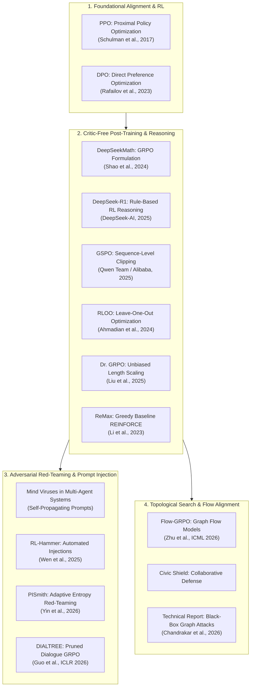

# Research Papers & Technical Reports Repository

This directory archives key foundational and modern research papers, empirical literature, and technical reports informing the **Adaptive Defense for Multi-Agent Systems** capstone project.

---

## 1. Research Taxonomy Overview

The diagram below categorizes the literature supporting our post-training reinforcement learning, adversarial red-teaming, and multi-agent defense architecture:

---

## 2. Catalog of Research Papers (`papers/`)

The table below catalogs all primary research papers archived locally in [`papers/`](file:///home/student-14/capstone/docs/03-research-papers/papers):

| Paper Title & Venue | Authors & Year | Local PDF Archive | Focus & Capstone Relevance | External Reference |
| :--- | :--- | :--- | :--- | :--- |
| **DeepSeekMath: Pushing the Limits of Mathematical Reasoning in Open Language Models** | Shao et al. (2024) | [`DeepSeekMath_Mathematical_Reasoning_GRPO.pdf`](file:///home/student-14/capstone/docs/03-research-papers/papers/DeepSeekMath_Mathematical_Reasoning_GRPO.pdf) | Introduces **Group Relative Policy Optimization (GRPO)**, eliminating the critic network via cohort advantage standardization. | [arXiv:2402.03300](https://arxiv.org/abs/2402.03300) |
| **DeepSeek-R1: Incentivizing Reasoning Capability in LLMs via Reinforcement Learning** | DeepSeek-AI (2025) | [`DeepSeek_R1_Incentivizing_Reasoning_Capability_via_RL.pdf`](file:///home/student-14/capstone/docs/03-research-papers/papers/DeepSeek_R1_Incentivizing_Reasoning_Capability_via_RL.pdf) | Proves large-scale rule-based reasoning (RLVR) using GRPO without supervised warm-up demonstrations. | [arXiv:2501.12948](https://arxiv.org/abs/2501.12948) |
| **Group Sequence Policy Optimization (GSPO)** | Qwen Team / Alibaba (2025) | [`GSPO_Group_Sequence_Policy_Optimization.pdf`](file:///home/student-14/capstone/docs/03-research-papers/papers/GSPO_Group_Sequence_Policy_Optimization.pdf) | Replaces token-level importance sampling with length-normalized sequence ratios $s_i(\theta)$, preventing MoE and long-chain collapse. | [arXiv:2507.18071](https://arxiv.org/abs/2507.18071) |
| **Back to Basics: Revisiting REINFORCE Style Optimization for Language Model Alignment (RLOO)** | Ahmadian et al. (2024) | [`RLOO_Back_to_Basics_REINFORCE_Alignment.pdf`](file:///home/student-14/capstone/docs/03-research-papers/papers/RLOO_Back_to_Basics_REINFORCE_Alignment.pdf) | Formulates an unbiased leave-one-out baseline ($A_i = R_i - \frac{1}{K-1}\sum_{j \neq i} R_j$) removing variance-scaling distortions from standard deviation division. | [arXiv:2402.14740](https://arxiv.org/abs/2402.14740) |
| **Understanding R1-Zero-Like Training: A Critical Perspective (Dr. GRPO)** | Liu et al. (2025) | [`Dr_GRPO_Understanding_R1_Zero_Like_Training.pdf`](file:///home/student-14/capstone/docs/03-research-papers/papers/Dr_GRPO_Understanding_R1_Zero_Like_Training.pdf) | Identifies verbosity exploitation where models output rambling tokens to dampen negative gradients; proposes unbiased constant length normalization. | [arXiv:2503.20783](https://arxiv.org/abs/2503.20783) |
| **ReMax: A Simple, Effective, and Efficient Reinforcement Learning Method for Aligning LLMs** | Li et al. (2023) | [`ReMax_Efficient_Reinforcement_Learning_for_LLM_Alignment.pdf`](file:///home/student-14/capstone/docs/03-research-papers/papers/ReMax_Efficient_Reinforcement_Learning_for_LLM_Alignment.pdf) | High-efficiency RLHF using deterministic greedy rollout as baseline ($A_i = R_{\text{stoch}} - R_{\text{greedy}}$), cutting inference compute by ~75%. | [arXiv:2310.10505](https://arxiv.org/abs/2310.10505) |
| **PISmith: Reinforcement Learning-Based Red Teaming for Prompt Injection** | Yin et al. (2026) | [`PISmith_RL_Red_Teaming_Prompt_Injection.pdf`](file:///home/student-14/capstone/docs/03-research-papers/papers/PISmith_RL_Red_Teaming_Prompt_Injection.pdf) | Employs adaptive entropy regularization and dynamic advantage weighting to escape 0% ASR cold-start learning freeze against hardened targets. | [arXiv:2603.13026](https://arxiv.org/abs/2603.13026) |
| **DIALTREE: Tree-Based Dialogue Reinforced Policy Optimization for Red-Teaming** | Guo et al. (ICLR 2026) | [`DIALTREE_Tree_Based_Dialogue_Policy_Optimization_Red_Teaming.pdf`](file:///home/student-14/capstone/docs/03-research-papers/papers/DIALTREE_Tree_Based_Dialogue_Policy_Optimization_Red_Teaming.pdf) | Combines Monte Carlo tree search with Dialogue-GRPO and adaptive format masking to preserve syntactical prompt structures. | [arXiv:2510.02286](https://arxiv.org/abs/2510.02286) |
| **RL Is a Hammer and LLMs Are Nails: A Simple RL Recipe for Strong Prompt Injection (RL-Hammer)** | Wen et al. (2025) | [`RL_Hammer_Simple_RL_Recipe_Prompt_Injection.pdf`](file:///home/student-14/capstone/docs/03-research-papers/papers/RL_Hammer_Simple_RL_Recipe_Prompt_Injection.pdf) | Demonstrates on-policy GRPO automated prompt injection against instruction-hierarchy defended models. | [arXiv:2510.04885](https://arxiv.org/abs/2510.04885) |
| **Training Graph Flow Models with Reinforcement Learning (Flow-GRPO)** | Zhu et al. (ICML 2026) | [`Flow_GRPO_Training_Graph_Flow_Models_RL.pdf`](file:///home/student-14/capstone/docs/03-research-papers/papers/Flow_GRPO_Training_Graph_Flow_Models_RL.pdf) | Formulates discrete graph flow alignment using trajectory-level group advantage over molecular and structural manifolds. | [arXiv:2603.10395](https://arxiv.org/abs/2603.10395) |
| **Proximal Policy Optimization Algorithms (PPO)** | Schulman et al. (2017) | [`PPO_Proximal_Policy_Optimization_Algorithms.pdf`](file:///home/student-14/capstone/docs/03-research-papers/papers/PPO_Proximal_Policy_Optimization_Algorithms.pdf) | Foundational actor-critic baseline utilizing clipped surrogate loss and Generalized Advantage Estimation (GAE). | [arXiv:1707.06347](https://arxiv.org/abs/1707.06347) |
| **Direct Preference Optimization: Your Language Model Is Secretly a Reward Model (DPO)** | Rafailov et al. (NeurIPS 2023) | [`DPO_Direct_Preference_Optimization.pdf`](file:///home/student-14/capstone/docs/03-research-papers/papers/DPO_Direct_Preference_Optimization.pdf) | Foundational offline preference optimization bypassing explicit reward modeling and online RL loops. | [arXiv:2305.18290](https://arxiv.org/abs/2305.18290) |
| **Mind Viruses: Self-Propagating Ideas in Multi-Agent LLM Systems** | Academic Pre-print | [`Mind Viruses- Self-Propagating Ideas in Multi-Agent LLM Systems.pdf`](file:///home/student-14/capstone/docs/03-research-papers/papers/Mind%20Viruses-%20Self-Propagating%20Ideas%20in%20Multi-Agent%20LLM%20Systems.pdf) | Foundational threat model for epidemic spread of malicious instructions across autonomous multi-agent networks. | Internal Repository Archive |
| **Civic Shield** | Research Preprint | [`civic_shield.pdf`](file:///home/student-14/capstone/docs/03-research-papers/papers/civic_shield.pdf) | Collaborative multi-agent defense architectures under adversarial prompt environments. | Internal Repository Archive |
| **RLredAgent: Automated Prompt Injection** | Research Preprint | [`RLredAgent_promptInjection.pdf`](file:///home/student-14/capstone/docs/03-research-papers/papers/RLredAgent_promptInjection.pdf) | Preliminary reinforcement learning formulation for automated black-box prompt injection. | Internal Repository Archive |

---

## 3. Technical Reports (`technical_reports/`)

* [**Formulating Black-Box Graph Adversarial Attacks via Group Relative Policy Optimization (GRPO)**](file:///home/student-14/capstone/docs/03-research-papers/technical_reports/GRPO_Black-Box_Graph_Attacks.md)
  * **Authors:** Neel Chandrakar, Pranav Ballebail, Pranav Kaushal, Pranav Swaroop (Batch 14, PES University)
  * **Focus:** Deep mathematical formulation of translating critic-free GRPO to discrete graph topologies ($A_{\text{comm}}$ and GNN adjacency), addressing credit assignment and spectral consensus collapse ($\rho(A_{\text{comm}}) \ge 1$).
* [**OpenAI-Hugging Face Incident Technical Report**](file:///home/student-14/capstone/docs/03-research-papers/technical_reports/OpenAI-Hugging-Face%20Incident-Technical-Report.pdf)
  * Real-world post-mortem on supply chain prompt injection and remote code execution vulnerabilities in distributed model hubs.
