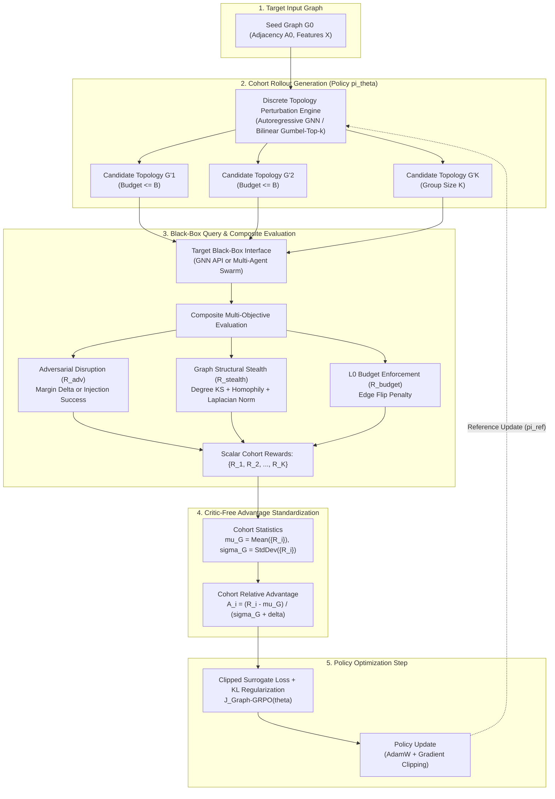

# Formulating Black-Box Graph Adversarial Attacks via Group Relative Policy Optimization

Adversarial machine learning on graph-structured data represents a distinct challenge within algorithmic security: the underlying search space is inherently discrete, non-Euclidean, and combinatorial [cite: 1]. Whereas continuous gradient-based adversaries operate effectively across Euclidean inputs such as computer vision and audio signals, perturbing graph topologies—via edge additions, deletions, or node attribute modifications—requires navigating an expansive combinatorial manifold [cite: 1, 2]. In realistic operational environments, adversaries rarely possess access to target model architectures, internal weights, or backpropagated gradients; they are restricted to black-box query interfaces, receiving only confidence vectors, top-1 hard labels, or downstream execution outputs [cite: 3, 4, 5].

Historically, reinforcement learning (RL) frameworks such as RL-S2V and actor-critic variants served as the primary paradigm for learning query-efficient black-box graph attacks [cite: 2, 6]. However, traditional RL paradigms depend heavily on parameterized value networks (critics) to approximate state-action values across combinatorial structures [cite: 1, 6]. These critic networks suffer severe empirical pathologies, including Bellman error compounding over non-smooth graph landscapes, sample inefficiency, and gradient variance explosion under delayed, sparse reward signals [cite: 6, 7, 8]. 

The introduction of Group Relative Policy Optimization (GRPO) demonstrates that eliminating the critic in favor of group-normalized relative advantage estimation over a cohort of candidate outputs produces stable, sample-efficient policy updates [cite: 8, 9, 10]. Adapting GRPO to non-sequence topologies—spanning static Graph Neural Network (GNN) classifiers and dynamic Multi-Agent System (MAS) communication graphs—provides a principled mathematical mechanism to resolve critic instability while optimizing discrete topological attacks [cite: 11, 12, 13].

---



---

## Discrete Black-Box Graph Adversarial Attacks

Attacking graph-structured classifiers requires formulating topological alterations under strict constraints to preserve the underlying semantic identity of the graph [cite: 1, 6]. In node-level, link-level, or graph-level tasks, the target model maps an input graph $G = (\mathcal{V}, \mathcal{E})$ with node feature matrix $X \in \mathbb{R}^{|\mathcal{V}| \times d}$ and binary adjacency matrix $A \in \{0, 1\}^{|\mathcal{V}| \times |\mathcal{V}|}$ to predictions $f(G) \in \mathcal{Y}$ [cite: 6, 7]. The adversarial objective is to construct a perturbed graph $G' = (\mathcal{V}', \mathcal{E}')$ that induces misclassification while maintaining imperceptibility under a budget constraint $\|\Delta E\|_0 \le B$ [cite: 4, 6].

### Taxonomy of Attack Modalities

Graph adversarial attacks are categorized across operational access levels, temporal intervention stages, and optimization mechanisms:

| Attack Modality | Model Access Level | Optimization Mechanism | Information Feedback | Representative Approaches | Core Structural Limitations |
| :--- | :--- | :--- | :--- | :--- | :--- |
| **Query-Based Soft-Label Evasion** | Black-box query access | Zeroth-order optimization, evolutionary search, policy gradients [cite: 6, 7]. | Continuous prediction probabilities $P(y \mid G')$ [cite: 6, 7]. | RL-S2V (soft setting), Genetic Algorithms [cite: 1, 6]. | Vulnerable to defensive confidence masking and query rate limits [cite: 3, 4]. |
| **Query-Based Hard-Label Evasion** | Black-box query access | Combinatorial ray-searching, boundary distance approximation [cite: 3, 4]. | Discrete decision label $\hat{y} \in \mathcal{Y}$ only [cite: 3, 4]. | Hard-Label GNN Attack [cite: 4]. | Extreme query complexity; high boundary variance [cite: 4]. |
| **Transfer-Based Attacks** | Zero-query target access; surrogate access | Gradient sign methods (FGSM), Projected Gradient Descent (PGD) on surrogate [cite: 2, 4]. | Surrogate gradients $\nabla_A \mathcal{L}_{\text{surr}}$ [cite: 2, 4]. | Nettack, PGD topology transfer [cite: 2, 4]. | Poor transferability across distinct message-passing architectures [cite: 2, 5]. |
| **Strict Zero-Query Attacks** | Zero-query target access; structural data only | Spectral filter perturbation, node centrality heuristics [cite: 5, 14]. | None (unsupervised topology metrics) [cite: 5]. | STACK [cite: 5, 14]. | Suboptimal against adversarially trained or non-spectral GNN models [cite: 5, 14]. |
| **Sequential Reinforcement Learning** | Black-box query access | Markov Decision Process (MDP), Q-learning, Actor-Critic [cite: 1, 6]. | Scalar target loss margin or terminal binary reward [cite: 6, 15]. | RL-S2V [cite: 1, 6]. | Critic overestimation bias, credit assignment failure, sample inefficiency [cite: 6, 16]. |

Query-based soft-label attacks leverage continuous probability vectors returned by the target endpoint to approximate gradient directions or guide exploration [cite: 6, 7]. When defenders restrict API responses to discrete predicted labels, hard-label attacks must approximate the distance to the classification decision boundary by searching along discrete rays in the graph space, an approach that dramatically increases query overhead [cite: 3, 4]. Transfer-based attacks sidestep query limits by constructing white-box surrogate models, yet their empirical transferability degrades significantly when the target system employs distinct message-passing aggregators or robust training objectives [cite: 2, 5]. 

Strict zero-query black-box attacks, exemplified by STACK, eliminate target interaction entirely [cite: 5, 14]. Instead of probing the model, STACK manipulates graph spectrum filters and centrality metrics (such as degree, betweenness, and eigenvector centrality) to disrupt structural message passing universally across downstream classifiers [cite: 5, 14]. Conversely, sequential reinforcement learning attacks, introduced by RL-S2V, model topological modification as a finite-horizon MDP [cite: 1, 6]. An agent sequentially flips edges guided by a parameterized Q-network, updating its value estimates based solely on the target model's terminal feedback [cite: 1, 6].

### Credit Assignment and Search Spaces in Discrete Graph Perturbations

In a graph containing $N = |\mathcal{V}|$ nodes, the discrete action space of possible edge additions or deletions scales quadratically as $\mathcal{O}(N^2)$ [cite: 1, 6]. Under a perturbation budget of $B$ edge flips, the combinatorial search space encompasses $\binom{N(N-1)/2}{B}$ possible topologies. Sequential RL attacks typically navigate this vast combinatorial space by decomposing decisions into hierarchical action steps:

$$a_t = (u_t, v_t) \sim \pi(u \mid s_t) \cdot \pi(v \mid u_t, s_t)$$

where the agent first selects an anchor node $u_t \in \mathcal{V}$, and then samples an adjacent or non-adjacent node $v_t \in \mathcal{V}$ conditioned on the representation of $u_t$ [cite: 1, 6].

The primary theoretical bottleneck in this setup is the credit assignment problem [cite: 16]. Modifying an individual edge $(u_t, v_t)$ at an intermediate step $t < B$ rarely triggers an immediate misclassification [cite: 6, 7]. Spatial GNNs aggregate feature representations across $K$-hop neighborhoods:

$$h_v^{(k)} = \text{UPDATE}^{(k)} \left( h_v^{(k-1)}, \text{AGGREGATE}^{(k)} \left( \left\{ h_u^{(k-1)} : u \in \mathcal{N}(v) \right\} \right) \right)$$

An individual edge insertion or deletion alters the localized spectral radius and localized Laplacian eigenvalues incrementally [cite: 5, 17]. Consequently, non-zero rewards are withheld until the terminal step $t = B$ [cite: 6, 7]. Distributing terminal credit across intermediate steps $\tau = (a_1, a_2, \dots, a_B)$ constitutes an intractable attribution dilemma: edges that contribute nothing to the final misclassification are frequently reinforced simply because they co-occur within a successful rollout [cite: 6, 16].

### Limitations of Classical RL in Discrete Graph Perturbations

Classical reinforcement learning algorithms—including Deep Q-Networks (DQN) and Actor-Critic variants such as Proximal Policy Optimization (PPO)—display fundamental structural deficiencies when applied to discrete graph rewiring:

In standard actor-critic formulations, a parameterized value network $V_\psi(s)$ must approximate the expected terminal loss over graph structures [cite: 8, 10]. However, graph topologies exhibit non-smooth, non-Lipschitz reward landscapes [cite: 5, 18]. Deleting a single critical bridge edge can cause the classification loss to spike sharply, whereas deleting any of several peripheral edges produces no observable change [cite: 5, 18]. The parameterized critic struggles to fit this step-function topology, leading to severe Bellman overestimation bias, erratic temporal difference (TD) errors:

$$\delta_t = r_t + \gamma V_\psi(s_{t+1}) - V_\psi(s_t)$$

and destabilized policy gradients [cite: 6, 8].

Standard RL formulations define intermediate step rewards as zero:

$$r(s_t, a_t) = 0 \quad \forall t < B$$

The terminal reward provides either a sparse binary success signal $r(s_B, a_B) \in \{-1, +1\}$ or a classification margin [cite: 6, 15]. With an action space of $\mathcal{O}(N^2)$ and horizon $B$, the probability of discovering an effective terminal trajectory through random exploration scales inversely with the size of the graph, causing gradient starvation [cite: 6, 19].

Deployed machine learning models and cloud APIs impose stringent rate limits, anti-crawling defenses, and monetary costs per query. Training a classical actor-critic agent requires millions of environment interactions to converge [cite: 19, 20]. The high query footprint of on-policy TD-learning renders classical RL impractical for real-world black-box auditing [cite: 3, 4].

---

## Group Relative Policy Optimization on Structured Topologies

Group Relative Policy Optimization (GRPO), introduced in *DeepSeekMath*, eliminates the parameterized value network entirely, replacing absolute state-value baselines with group-normalized empirical advantage estimators [cite: 8, 9, 10].

### Algorithmic Foundations: GRPO vs. PPO

In standard Proximal Policy Optimization (PPO), the objective maximizes a clipped surrogate function regularized by Generalized Advantage Estimation (GAE) [cite: 8, 10]:

$$\mathcal{J}_{\text{PPO}}(\theta) = \hat{\mathbb{E}}_t \left[ \min\left( \rho_t(\theta)\hat{A}_t^{\text{GAE}}, \, \text{clip}(\rho_t(\theta), 1-\epsilon, 1+\epsilon)\hat{A}_t^{\text{GAE}} \right) \right]$$

where $\rho_t(\theta) = \frac{\pi_\theta(a_t \mid s_t)}{\pi_{\theta_{\text{old}}}(a_t \mid s_t)}$, and the advantage $\hat{A}_t^{\text{GAE}} = \sum_{l=0}^\infty (\gamma \lambda)^l \delta_{t+l}^V$ depends directly on the critic network $V_\psi$ [cite: 8, 10].

GRPO removes $V_\psi(s)$ completely [cite: 8, 9, 10]. Given a prompt or initial conditioning state $q$ sampled from a dataset $\mathcal{D}$, the policy $\pi_{\theta_{\text{old}}}$ samples an ensemble of $G$ distinct candidate completions or actions $\{o_1, o_2, \dots, o_G\}$ [cite: 8, 21]. A scalar reward model evaluates each candidate to yield a set of scalar returns $\{R_1, R_2, \dots, R_G\}$ [cite: 8, 21]. The relative advantage $\hat{A}_i$ for each candidate output $o_i$ is computed by standardizing its scalar reward against the mean and standard deviation of its cohort [cite: 8, 21]:

$$\hat{A}_i = \frac{R_i - \text{mean}\left(\{R_1, \dots, R_G\}\right)}{\text{std}\left(\{R_1, \dots, R_G\}\right) + \delta}$$

where $\delta > 0$ is a small numerical stabilization constant [cite: 8, 21].

The GRPO policy loss is optimized over all decision steps or tokens $t \in \{1, \dots, |o_i|\}$ [cite: 8, 21]:

$$\mathcal{J}_{\text{GRPO}}(\theta) = \mathbb{E}_{q \sim \mathcal{D}, \{o_i\}_{i=1}^G \sim \pi_{\theta_{\text{old}}}(o|q)} \left[ \frac{1}{G}\sum_{i=1}^G \frac{1}{|o_i|}\sum_{t=1}^{|o_i|} \min \left( \rho_{i,t}(\theta)\hat{A}_i, \, \text{clip}(\rho_{i,t}(\theta), 1-\epsilon, 1+\epsilon)\hat{A}_i \right) - \beta \mathbb{D}_{\text{KL}}(\pi_\theta \parallel \pi_{\text{ref}}) \right]$$

where $\rho_{i,t}(\theta) = \frac{\pi_\theta(o_{i,t} \mid q, o_{i,<t})}{\pi_{\theta_{\text{old}}}(o_{i,t} \mid q, o_{i,<t})}$, and the KL divergence penalty is computed step-wise against a frozen reference policy $\pi_{\text{ref}}$ using the unbiased, non-negative estimator [cite: 8, 10, 21]:

$$\mathbb{D}_{\text{KL}}(\pi_\theta \parallel \pi_{\text{ref}}) = \frac{\pi_{\text{ref}}(o_{i,t} \mid q, o_{i,<t})}{\pi_\theta(o_{i,t} \mid q, o_{i,<t})} - \log \left( \frac{\pi_{\text{ref}}(o_{i,t} \mid q, o_{i,<t})}{\pi_\theta(o_{i,t} \mid q, o_{i,<t})} \right) - 1$$

| Algorithmic Dimension | Proximal Policy Optimization (PPO) | Group Relative Policy Optimization (GRPO) |
| :--- | :--- | :--- |
| **Critic Architecture** | Requires dedicated value network $V_\psi(s)$ [cite: 8, 10]. | Eliminates critic network entirely [cite: 8, 9, 10]. |
| **Advantage Estimation** | Generalized Advantage Estimation (GAE) across sequential steps [cite: 8, 10]. | Empirical standardization across a cohort of $G$ sampled candidates [cite: 8, 21]. |
| **Memory Footprint** | High; requires holding actor and critic models concurrently in VRAM [cite: 8, 10]. | Low; memory reserved solely for policy and reference forward passes [cite: 8, 10]. |
| **Baseline Normalization** | Absolute baseline parameterized by $V_\psi(s_t)$ [cite: 8, 22]. | Relative cohort baseline ($\mu_G$, $\sigma_G$) per seed instance [cite: 8, 22]. |
| **Regularization Handling** | Implicit trust region or entropy bonus in loss [cite: 8, 10]. | Explicit token-level / step-level KL divergence penalty against $\pi_{\text{ref}}$ [cite: 8, 10]. |

### Extensions to Graph and Tree Structures

The structural simplicity and variance reduction properties of GRPO have spurred adaptations outside traditional linear sequence modeling:

In multi-agent systems, optimizing communication routing among heterogeneous LLM agents historically struggled with edge-level credit assignment [cite: 12, 16]. Cang et al. formulate communication topology learning via GRPO [cite: 12]. For a given collaborative problem query $q$, the policy samples a group of discrete adjacency topologies [cite: 12]. The entire multi-agent system executes under each topology, receiving task performance rewards [cite: 12]. GRPO standardizes rewards across topologies, bypassing noisy per-edge credit attribution and identifying critical communication links and cycle properties [cite: 12, 18, 23].

Discrete flow-matching models for molecular and structural graph generation struggle when optimized via standard REINFORCE or PPO due to high gradient variance across Monte Carlo steps [cite: 11, 24, 25]. Zhu et al. utilize GRPO over discrete graph flow denoising trajectories [cite: 11, 26]. By deriving an analytic transition rate matrix, the framework updates the denoiser via group-relative rewards computed over structural molecular oracles (e.g., binding affinity, planarity), achieving state-of-the-art results on 23 PMO benchmarks [cite: 11, 24, 26].

Red-teaming conversational targets across multi-turn horizons involves combinatorial dialogue tree spaces [cite: 13, 27]. DIALTREE integrates tree-structured rollouts with Dialogue-GRPO [cite: 13, 28]. The attacker policy branches across dialogue states, pruning non-viable trajectories and standardizing rewards relative to the dialogue cohort [cite: 13, 27]. DIALTREE introduces adaptive format masking: when a dialogue trajectory produces negative relative advantage ($\hat{A}_i < 0$), gradients on syntax and formatting tokens are masked to prevent structural degeneration of the adversarial prompt [cite: 13].

In automated prompt injection, sparse rewards cause standard policy gradients to fail [cite: 20, 29, 30]. PISmith and RL-Hammer apply GRPO to train attacker models against robust defenses (such as Meta-SecAlign and Instruction Hierarchy) [cite: 20, 29, 30]. PISmith resolves reward sparsity through adaptive entropy regularization—activating an entropy bonus when policy uncertainty collapses below a threshold $\mathcal{H}_{\text{cap}}$—and dynamic advantage weighting, which amplifies learning from rare successful injections when cohort success rates approach zero [cite: 20, 30].

### Credit Assignment: Cohort Normalization vs. Step-Level GAE

Classical graph reinforcement learning (such as RL-S2V) relies on step-level credit assignment, attempting to learn the exact margin delta attributable to edge flip $e_t$ [cite: 1, 6]. This temporal decomposition suffers from structural friction: individual edge insertions exhibit severe combinatorial non-linearity [cite: 1, 6]. The presence of edge $e_1$ might only produce an adversarial effect if edge $e_2$ is concurrently present (e.g., creating an alternative 2-hop bypass around a defensive node bottleneck) [cite: 16, 17]. 

Step-level Generalized Advantage Estimation (GAE) attempts to decompose this non-linear interaction into additive sequential advantages:

$$\hat{A}_t^{\text{GAE}} = \delta_t + \gamma \lambda \delta_{t+1} + \dots$$

This assumption breaks on combinatorial graphs [cite: 6, 16]. In contrast, group sampling treats the entire perturbation trajectory:

$$G'_i = G_0 \oplus \Delta E_i$$

as a cohesive action [cite: 12, 16]. By sampling a cohort of $K$ candidate perturbed graphs $\{G'_1, G'_2, \dots, G'_K\}$ conditioned on the seed graph $G_0$, GRPO normalizes performance across structural mutations [cite: 8, 12]. This baseline subtraction eliminates the intrinsic difficulty of the underlying graph instance $G_0$—some graphs are inherently more robust than others—allowing the policy gradient to isolate perturbations that outperform the structural cohort average [cite: 8, 12, 22].

---

## Systematic Literature Matrix

The comparative matrix below maps foundational and modern literature across graph attacks, critic-free reinforcement learning, and structural red-teaming:

| Reference & Venue | Setting & Threat Model | Target Model & Modality | Optimization Method | Advantage Mechanism | Core Strengths | Key Vulnerabilities & Limitations |
| :--- | :--- | :--- | :--- | :--- | :--- | :--- |
| **RL-S2V**<br>Dai et al.<br>*ICML 2018* [cite: 6] | Black-box query evasion / poisoning; budget $\|\Delta E\|_0 \le m$ [cite: 1, 6]. | Node & graph classification (GCN, GraphSAGE) [cite: 1, 6]. | Q-learning with Structure2Vec embedding [cite: 1, 6]. | Hierarchical Bellman TD error $\delta_t = r + \gamma \max Q - Q$ [cite: 1, 6]. | First formalization of graph attacks as discrete MDPs; generalizes to unseen graphs [cite: 6, 7]. | Severe sample inefficiency; critic overestimation; sparse terminal reward collapse [cite: 6, 7]. |
| **STACK**<br>Xu et al.<br>*AAAI 2022* [cite: 5, 14] | Strict zero-query black-box; no target feedback [cite: 5, 14]. | Node classification across diverse GNN architectures [cite: 5, 14]. | Gradient-free spectral filter perturbation [cite: 5, 14]. | None (Deterministic graph-theoretic heuristics) [cite: 5]. | Zero query overhead; completely circumvents black-box detection/rate limits [cite: 5]. | Suboptimal against adversarially trained or non-spectral GNN defenses; lacks task adaptivity [cite: 5, 14]. |
| **DeepSeekMath**<br>Shao et al.<br>*arXiv 2024* [cite: 9] | Generative sequence modeling / mathematical reasoning [cite: 8, 9]. | Autoregressive LLMs (DeepSeek-7B) [cite: 8, 9]. | Group Relative Policy Optimization (GRPO) [cite: 8, 9]. | Cohort normalization: $\hat{A}_i = \frac{R_i - \mu_{\{R\}}}{\sigma_{\{R\}} + \delta}$ [cite: 8, 21]. | Eliminates critic network; cuts memory footprint; stabilizes policy updates [cite: 8, 10]. | Prone to entropy collapse and reward hacking under unregularized binary rewards [cite: 10, 20, 30]. |
| **Graph-GRPO**<br>Cang et al.<br>*ACL Findings 2026* [cite: 12] | Cooperative Multi-Agent Systems; communication topology search [cite: 12]. | LLM-based agent swarms (reasoning & code generation) [cite: 12, 23]. | GRPO over discrete agent-communication graphs [cite: 12]. | Group-relative advantage over candidate communication graphs [cite: 12]. | Solves per-edge credit assignment in multi-agent systems; optimizes cycle rank [cite: 12, 18]. | Evaluated primarily on cooperative rather than adversarial settings; relies on static group sizes [cite: 12]. |
| **Graph-GRPO**<br>Zhu et al.<br>*ICML 2026* [cite: 11, 25] | Generative graph flow alignment under verifiable rewards [cite: 11, 24]. | Discrete Graph Flow Models (DeFoG backbone) [cite: 11, 24, 26]. | Flow-GRPO with analytic rate matrices [cite: 11, 24, 26]. | Trajectory-level group advantage on molecular properties [cite: 11, 24]. | Differentiable transition probabilities; high structural validity on molecular oracles [cite: 11, 24, 26]. | Requires complex analytic rate formulations; high compute during iterative refinement [cite: 24, 26]. |
| **DIALTREE**<br>Guo et al.<br>*ICLR 2026* [cite: 13, 28] | Multi-turn conversational black-box red-teaming [cite: 13, 27]. | Conversational LLMs (12 target commercial models) [cite: 13, 27]. | Tree-search Dialogue-GRPO with pruning [cite: 13, 28]. | Group advantage over pruned dialogue tree rollouts [cite: 13, 27]. | Discovers multi-step strategic jailbreaks; adaptive format masking prevents syntax decay [cite: 13, 27]. | High query fan-out across tree branches; limited to conversational input spaces [cite: 13, 27]. |
| **RL-Hammer**<br>Wen et al.<br>*Preprint 2025/2026* [cite: 29] | Automated prompt injection against agentic workflows [cite: 29]. | Defended LLM agents (SecAlign, Instruction Hierarchy) [cite: 29]. | On-policy GRPO without warm-up data [cite: 29]. | Relative advantage over injection candidate batches [cite: 29]. | Achieves high ASR on frontier targets without curated demonstration sets [cite: 29]. | Struggles when attacking hardened frontier targets from a cold start (0% ASR initial signal) [cite: 20, 31]. |
| **PISmith**<br>Yin et al.<br>*Preprint 2026* [cite: 20, 32] | Black-box prompt injection red-teaming under extreme defense [cite: 20, 32]. | LLM agents & frontier targets (GPT-5-nano, SecAlign-8B) [cite: 19, 20]. | GRPO with Adaptive Entropy & Dynamic Advantage [cite: 20, 30]. | Reward-conditioned entropy and amplified advantage for rare successes [cite: 20, 30]. | Prevents entropy collapse; turns near-zero baseline ASR into high success [cite: 20, 30, 33]. | Requires hyperparameter tuning of entropy caps and reward thresholds [cite: 20, 30]. |

---

## Mathematical Framework and Policy Formulation

Translating GRPO to discrete graph adversarial attacks requires mapping graph modifications to a cohort optimization setting, establishing robust policy parameterizations, and designing composite rewards that incorporate adversarial loss, imperceptibility, and budget constraints [cite: 6, 8, 12].

### MDP Formulation and Action Parameterizations

Let the attack space be formulated as a discrete decision process over graph topologies [cite: 6, 7]. Given an initial target graph $G_0 = (\mathcal{V}, \mathcal{E}_0)$ with adjacency matrix $A_0 \in \{0, 1\}^{N \times N}$ and node feature matrix $X \in \mathbb{R}^{N \times d}$, an attacker operating under budget $B$ generates a perturbed adjacency matrix $A' = A_0 \oplus \Delta A$, where $\Delta A \in \{-1, 0, 1\}^{N \times N}$ represents edge additions and deletions, subject to $\frac{1}{2}\|\Delta A\|_0 \le B$ [cite: 4, 6].

Two policy parameterization regimes can execute this process:

In the autoregressive regime, the policy sequentially selects $B$ discrete edge flips:

$$\tau = (a_1, a_2, \dots, a_B)$$

where $a_t = (u_t, v_t)$ [cite: 1, 6]. At step $t$, a graph neural network (or Graph Transformer) encodes the intermediate graph $G^{(t-1)}$ into node latent representations:

$$H^{(t-1)} = \text{GNN}_\theta(A^{(t-1)}, X)$$

The selection probability factors as:

$$\pi_\theta(a_t \mid G^{(t-1)}) = \pi_\theta(u_t \mid G^{(t-1)}) \cdot \pi_\theta(v_t \mid u_t, G^{(t-1)})$$

This matches the sequential formulation of RL-S2V while optimizing via cohort advantages rather than TD learning [cite: 6, 12].

In the one-shot regime, the policy evaluates all potential edges simultaneously [cite: 12, 16]. The encoder computes node representations $h_u, h_v \in \mathbb{R}^{d_{\text{latent}}}$, and a bilinear scoring head parameterizes the edge probability distribution:

$$S_{uv} = \frac{h_u^\top W_\theta h_v}{\sqrt{d_{\text{latent}}}}$$

$$P((u, v) \in \mathcal{E}') = \sigma(S_{uv})$$

A candidate adjacency matrix $A'$ is obtained by sampling top-$B$ links via Gumbel-Top-$k$ sampling or Bernoulli sampling with budget projection [cite: 4, 12].

### Composite Multi-Objective Reward

A successful graph attack must simultaneously fool the black-box target model, maintain structural stealth, and satisfy the perturbation budget [cite: 4, 5, 6]. The composite scalar reward function $R(G'_i)$ for candidate graph $G'_i$ is structured into three distinct objective terms:

$$R(G'_i) = \mathcal{R}_{\text{adv}}(G'_i) + \mathcal{R}_{\text{stealth}}(G'_i) + \mathcal{R}_{\text{budget}}(G'_i)$$

#### Black-Box Adversarial Success Margin ($\mathcal{R}_{\text{adv}}$)
Depending on API feedback granularity, the adversarial objective rewards margin disruption or hard-label shifts [cite: 3, 4, 6]:

When continuous confidence vectors are accessible, let $f_c(G')$ denote the target classifier's output probability for class $c$, and $y$ denote the ground-truth label [cite: 6, 7]. The margin reward is formulated as:

$$\mathcal{R}_{\text{adv}}(G'_i) = \max_{c \neq y} f_c(G'_i) - f_y(G'_i)$$

This continuous margin provides informative gradient signals even prior to a classification label flip [cite: 6, 7]. When only discrete predictions $\hat{y} = f(G')$ are returned, a zero-one indicator combined with an empirical surrogate boundary approximation is employed [cite: 3, 4]:

$$\mathcal{R}_{\text{adv}}(G'_i) = \begin{cases} +1.0 & \text{if } f(G'_i) \neq y \\ -1.0 & \text{if } f(G'_i) = y \end{cases}$$

#### Graph Imperceptibility and Structural Stealth ($\mathcal{R}_{\text{stealth}}$)
Adversarial attacks on graphs often alter topological invariants, rendering them detectable by graph defense algorithms (e.g., SVD filtering or homophily audits) [cite: 4, 34]. The stealth reward penalizes deviations across three fundamental graph-theoretic distributions:

$$\mathcal{R}_{\text{stealth}}(G'_i) = -\lambda_{\text{deg}} D_{\text{KS}}(\mathcal{D}(G'_i), \mathcal{D}(G_0)) - \lambda_{\text{hom}} |\mathcal{H}(G'_i) - \mathcal{H}(G_0)| - \lambda_{\text{spec}} \|\mathbf{\Lambda}(G'_i) - \mathbf{\Lambda}(G_0)\|_2$$

The Kolmogorov-Smirnov statistic $D_{\text{KS}}(\mathcal{D}(G'_i), \mathcal{D}(G_0))$ compares the cumulative degree distributions of the candidate and seed graphs, penalizing artificial hub generation [cite: 5]. The edge homophily metric $\mathcal{H}(G) = \frac{\sum_{(u, v) \in \mathcal{E}} \mathbb{I}(y_u = y_v)}{|\mathcal{E}|}$ ensures preservation of community cohesion; naive attacks add inter-class edges, causing sharp homophily drops that are easily flagged by sanitization layers [cite: 5, 34]. The spectral distance term $\|\mathbf{\Lambda}(G'_i) - \mathbf{\Lambda}(G_0)\|_2$ compares the top-$k$ eigenvalues of the normalized graph Laplacian $\tilde{L} = I - D^{-1/2} A D^{-1/2}$, ensuring the global spectral filter characteristics of the graph are preserved, mitigating detection by low-rank matrix approximation defenses [cite: 4, 5].

#### Strict Perturbation Budget Penalty ($\mathcal{R}_{\text{budget}}$)
To enforce the operational budget $B$:

$$\mathcal{R}_{\text{budget}}(G'_i) = -\alpha \max\left(0, \, \frac{1}{2}\|A'_i - A_0\|_0 - B\right)$$

where $\alpha$ is a large penalty coefficient ensuring that violating the budget constraint yields a net negative return [cite: 6].

### Group Relative Advantage and Degenerate Minima Suppression

For each target graph $G_0$, the policy $\pi_{\theta_{\text{old}}}$ samples a group of $K$ candidate perturbed graphs $\{G'_1, G'_2, \dots, G'_K\}$ [cite: 8, 12]. The group-relative advantage $\hat{A}_i$ is computed as:

$$\hat{A}_i = \frac{R(G'_i) - \mu_G}{\sigma_G + \delta}, \quad \text{where } \mu_G = \frac{1}{K}\sum_{j=1}^K R(G'_j), \quad \sigma_G = \sqrt{\frac{1}{K}\sum_{j=1}^K \left( R(G'_j) - \mu_G \right)^2}$$

This group normalization introduces a self-policing mechanism against degenerate topological local minima [cite: 8, 12]. In unconstrained graph attacks, a common failure mode is topological isolation: the attacker achieves misclassification simply by severing all incident edges to the target node, disconnecting it from its neighborhood [cite: 7]. While this optimizes the adversarial loss $\mathcal{L}_{\text{adv}}$, it creates an immediate outlier in the degree distribution and produces a severe eigenvalue perturbation in the graph Laplacian [cite: 4, 5]. 

Under the composite reward, such degenerate candidates receive an extreme penalty from $\mathcal{R}_{\text{stealth}}$, driving $R(G'_i) \ll \mu_G$ and resulting in $\hat{A}_i < 0$. Because GRPO clips and suppresses policies that generate negative-advantage actions, the parameter updates deliberately decrease the log-probabilities of generating disconnected or structurally degenerate graphs relative to non-trivial adversarial solutions [cite: 8, 13].

### Full Clipped Surrogate Loss with KL Regularization

The complete training objective for the GRPO Graph Attacker integrates the clipped surrogate objective, group advantage, and an explicit Kullback-Leibler (KL) divergence penalty against the reference initialization policy $\pi_{\text{ref}}$ [cite: 8, 21]:

$$\mathcal{J}_{\text{Graph-GRPO}}(\theta) = \mathbb{E}_{G_0 \sim \mathcal{D}, \{G'_i\}_{i=1}^K \sim \pi_{\theta_{\text{old}}}(G \mid G_0)} \left[ \frac{1}{K}\sum_{i=1}^K \min \left( \rho_i(\theta)\hat{A}_i, \, \text{clip}(\rho_i(\theta), 1-\epsilon, 1+\epsilon)\hat{A}_i \right) - \beta \mathbb{D}_{\text{KL}}(\pi_\theta(G'_i \mid G_0) \parallel \pi_{\text{ref}}(G'_i \mid G_0)) \right]$$

where the importance weight ratio for graph $G'_i$ parameterized over edge actions $a_t \in \Delta E_i$ is given by [cite: 8]:

$$\rho_i(\theta) = \frac{\pi_\theta(G'_i \mid G_0)}{\pi_{\theta_{\text{old}}}(G'_i \mid G_0)} = \prod_{t=1}^{|\Delta E_i|} \frac{\pi_\theta(a_t \mid G^{(t-1)})}{\pi_{\theta_{\text{old}}}(a_t \mid G^{(t-1)})}$$

and the KL penalty prevents the policy from deviating excessively from its pre-trained initialization, maintaining generative stability throughout optimization [cite: 8, 10, 13].

---

## Algorithmic Execution Pipeline

The algorithmic loop below details the critic-free training process for the black-box graph adversary, executing cohort generation, parallel querying, advantage computation, and policy updates:

```python
# Algorithmic Training Loop: GRPO Black-Box Graph Adversary
# Hyperparameters: Group size K, Clip epsilon, KL coeff beta, Budget B, Learning rate eta

Initialize policy network pi_theta (Graph Transformer / GNN)
Initialize reference policy pi_ref = copy(pi_theta)
Initialize optimizer AdamW(pi_theta.parameters(), lr=eta)

for iteration in 1, ..., MaxIterations:
    # 1. Sample batch of seed graphs from target distribution
    Batch_G0 = SampleBatch(GraphDataset, batch_size=M)
    
    for G0 in Batch_G0:
        # 2. Rollout phase: generate cohort of candidate perturbed graphs
        Candidates = []
        with no_grad():
            for i in 1, ..., K:
                # Sample discrete perturbations up to budget B under current policy
                Delta_E_i = SampleActions(pi_theta, G0, budget=B)
                G_prime_i = ApplyPerturbation(G0, Delta_E_i)
                Candidates.append((G_prime_i, Delta_E_i))
        
        # 3. Parallel Black-Box API Evaluation
        # Query target model API concurrently across cohort to compute returns
        Rewards = []
        for (G_prime_i, Delta_E_i) in Candidates:
            L_blackbox = QueryBlackBoxAPI(G_prime_i)
            R_adv = ComputeAdversarialMargin(L_blackbox)
            R_stealth = ComputeStealthPenalty(G_prime_i, G0) # Degree KS, Homophily, Laplacian
            R_budget = ComputeBudgetPenalty(Delta_E_i, max_budget=B)
            
            Total_R = R_adv + R_stealth + R_budget
            Rewards.append(Total_R)
            
        # 4. Group Advantage Computation
        mu_group = Mean(Rewards)
        sigma_group = StdDev(Rewards) + 1e-8
        Advantages = [(r - mu_group) / sigma_group for r in Rewards]
        
        # 5. Policy Optimization Step (Critic-Free Update)
        optimizer.zero_grad()
        Loss = 0.0
        
        for i in 1, ..., K:
            (G_prime_i, Delta_E_i) = Candidates[i]
            A_i = Advantages[i]
            
            # Compute likelihood ratios over sequential edge decisions
            log_prob_curr = pi_theta.EvaluateLogProb(Delta_E_i, G0)
            log_prob_old  = log_prob_curr.detach()
            ratio = exp(log_prob_curr - log_prob_old)
            
            # Clipped surrogate objective
            surr1 = ratio * A_i
            surr2 = clamp(ratio, 1.0 - epsilon, 1.0 + epsilon) * A_i
            policy_loss = -min(surr1, surr2)
            
            # Unbiased token/edge-level KL regularization against reference policy
            log_prob_ref = pi_ref.EvaluateLogProb(Delta_E_i, G0)
            kl_div = exp(log_prob_ref - log_prob_curr) - (log_prob_ref - log_prob_curr) - 1.0
            
            Loss += (policy_loss + beta * kl_div) / K
            
        # Backpropagate and update policy weights
        Loss.backward()
        ClipGradients(pi_theta.parameters(), max_norm=1.0)
        optimizer.step()
        
    # Periodic update of reference weights
    if iteration % UpdateInterval == 0:
        pi_ref = copy(pi_theta)
```

---

## Dual Target Horizons: Static GNN Classifiers and Dynamic Multi-Agent Networks

The GRPO graph attack formulation generalizes across two primary architectures: static Graph Neural Network prediction endpoints and dynamic Multi-Agent System (MAS) communication graphs [cite: 6, 12, 18]. While both exhibit graph-structured dependency representations, their state spaces, vulnerability profiles, and failure manifestations diverge significantly [cite: 7, 17].

| System Dimension | Target A: Static GNN Prediction APIs | Target B: Dynamic Multi-Agent Networks |
| :--- | :--- | :--- |
| **Topological Representation** | Binary adjacency matrix $A \in \{0, 1\}^{N \times N}$ over data nodes [cite: 6, 7]. | Communication routing matrix $A_{\text{comm}} \in \{0, 1\}^{M \times M}$ over autonomous LLM agents [cite: 12, 17]. |
| **Node Semantics** | Static continuous entity features $x_v \in \mathbb{R}^d$ (e.g., text embeddings, chemical tokens) [cite: 1, 6]. | Autonomous LLM agents with conversational memory, system instructions, and tool access [cite: 18, 35]. |
| **Information Propagation** | Deterministic neural message passing (spatial aggregation / GNN layers) [cite: 6, 7]. | Asynchronous natural language dialogue, structured JSON tool calls, and context forwarding [cite: 17, 35]. |
| **Adversarial Failure Mode** | Misclassification of node label, erroneous link prediction, or wrong graph label [cite: 4, 6]. | Cascading prompt injection, unauthorized tool execution, consensus deadlocks, instruction laundering [cite: 17, 18, 35]. |
| **Query Feedback Mechanism** | Continuous confidence scores or discrete top-1 predicted labels [cite: 3, 4]. | Multi-agent execution traces, sandbox logs, tool outputs, and downstream text answers [cite: 20, 29]. |

### Target A: Static GNN APIs

In commercial GNN endpoints (such as credit fraud detection, molecular property screening, or social recommendation engines), the target model is a static, pre-trained neural network executing message-passing over fixed topologies [cite: 6, 11]. Queries are restricted by rate-limiting infrastructure and pay-per-query pricing [cite: 3, 4]. Attackers operate under a maximum query budget ($Q_{\text{max}} \le 1,000$). GRPO optimizes within this budget by sampling small cohort sizes ($K \in [4, 8]$), maintaining exploration efficiency without requiring millions of queries to train an internal critic [cite: 8, 21].

In node classification evasion, an attacker perturbs local 2-hop neighbor edges around a specific high-value node $v$ to induce classification label flipping without changing $v$'s explicit attributes [cite: 2, 6]. In link prediction disruption, adding deceptive structural bridges between disconnected communities collapses link-prediction heuristics in recommendation pipelines [cite: 5, 7]. In graph classification poisoning, inserting small subgraphs (e.g., dense motifs or high-betweenness cliques) flips the overall graph prediction (e.g., misclassifying toxic chemical compounds as benign) [cite: 4, 6].

### Target B: Multi-Agent Systems, Instruction Laundering, and Spectral Dynamics

Modern enterprise AI systems increasingly deploy collaborative multi-agent architectures (such as AutoGen, MetaGPT, ChatDev, and Magentic-One), where autonomous LLM instances collaborate across directed communication graphs $\mathcal{G}_{\text{comm}} = (\mathcal{V}_{\text{agent}}, \mathcal{E}_{\text{comm}})$ [cite: 18, 36]. Perturbing this topology alters the flow of instructions and context, exposing systemic security vulnerabilities [cite: 17, 18].

In single-agent environments, indirect prompt injections are bounded by the model's contextual window [cite: 35]. In contrast, multi-agent networks operate under transitive trust invariants: downstream execution agents (e.g., terminal code execution or financial transaction agents) implicitly trust inputs received from internal aggregation or planning agents [cite: 17, 35]. 

When an adversary modifies the communication topology—routing untrusted external web scrapers directly into an executive orchestrator's context—an *instruction laundering* chain occurs [cite: 35]. The injected payload is successively summarized, normalized, and repackaged by intermediate benign agents, systematically stripping away adversarial stylistic flags while preserving the malicious operational command [cite: 17, 35].

Information and falsehood diffusion across multi-agent systems adhere to non-linear propagation dynamics [cite: 17]. The susceptibility of an agent network to belief corruption or injection diffusion depends on the spectral radius $\rho(A_{\text{comm}})$ of the communication adjacency matrix:

$$\rho(A_{\text{comm}}) = \max_i |\lambda_i(A_{\text{comm}})|$$

When $\rho(A_{\text{comm}}) \ge 1$, errors and injected instructions do not dissipate; they amplify across iterative conversational turns [cite: 17]. Furthermore, empirical evaluations demonstrate that the directed cycle count (cycle rank) of an agent topology is strongly predictive of population homogenization and system collapse [cite: 18]. High cycle counts reduce agent diversity ($r = -0.68$, $\eta^2 = 0.24$), creating feedback loops that trap agents in consensus deadlocks or self-amplifying hallucinations [cite: 18].

Using GRPO, an adversary optimizes the communication graph to maximize injection propagation [cite: 12, 29]. By inserting communication edges between untrusted sensor agents and high-centrality orchestrator agents, or introducing cyclic routing to trap verification agents in infinite loops, the attacker drives the system toward compromise [cite: 17, 18]. Formulating rewards via execution tracing on agentic benchmarks (such as InjecAgent and AgentDojo) allows GRPO to isolate configurations that bypass tool sandboxes and trigger unauthorized real-world side effects with minimal communication overhead [cite: 8, 12, 29, 35]:

$$\mathcal{R}_{\text{MAS}} = \mathbb{I}(\text{Unauthorized Tool Call Executed}) - \gamma \cdot \text{TokenCost}$$

---

## Empirical Benchmarks, Failure Modes, and Defensive Feasibility

While GRPO provides a compelling mathematical foundation for discrete graph attacks, multiple theoretical and empirical failure modes arise when deploying group-relative optimization across non-Euclidean structures [cite: 12, 20].

### Failure Modes: Cold-Start and Reward Hacking

In unconstrained optimization, the policy exploits blind spots in the reward formulation [cite: 30]. If the spectral stealth penalty $\lambda_{\text{spec}}$ is weighted too low, the attacker policy converges to trivial bipartite disconnects or high-degree hub star topologies that break the target model by triggering numerical out-of-distribution errors in GNN aggregation layers [cite: 4, 5].

When attacking robustly defended models (e.g., GNNs with adversarial training or LLM agents guarded by Meta-SecAlign), the probability of finding a successful attack via random initial rollouts approaches zero:

$$R(G'_i) = 0 \quad \forall i \in \{1, \dots, K\}$$

When every candidate in the group receives identical zero rewards, the empirical standard deviation collapses to zero ($\sigma_{\{R\}} \to 0$) [cite: 19, 20]. Consequently, advantage estimation produces:

$$\hat{A}_i = \frac{0 - 0}{0 + \delta} = 0$$

The policy gradient vanishes entirely ($\nabla_\theta \mathcal{J} = 0$), trapping the attacker in a complete learning freeze [cite: 19, 20]. 

As established in PISmith, two architectural interventions are required:

Adaptive entropy regularization activates an entropy bonus when policy distribution entropy drops below $\mathcal{H}_{\text{cap}}$, ensuring continued structural exploration and preventing policy collapse [cite: 20, 30]. Dynamic target curriculums initialize training on weaker target models to establish baseline non-zero advantages before transitioning to frontier targets, ensuring that informative learning signals persist throughout training [cite: 19].

Generating $K$ candidate rollouts per graph across $M$ iterations scales total query consumption as:

$$Q_{\text{total}} = M \cdot K \cdot |\text{Batch}|$$

If $K = 16$ and $|\text{Batch}| = 8$, a single iteration consumes 128 black-box API queries. For commercial endpoints with rate caps (e.g., 60 RPM), unmanaged rollout generation triggers API throttling and automated anomaly detection [cite: 4, 20].

### Benchmarking Suites and Baseline Mitigations

Rigorous empirical validation demands systematic evaluation across both static graph robustness benchmarks and dynamic multi-agent security suites:

| Evaluation Domain | Benchmark Datasets / Suites | Target Models & Defenses | Evaluated Metrics | Baseline Competitors |
| :--- | :--- | :--- | :--- | :--- |
| **Static GNN Classifiers** | Cora, Citeseer, Pubmed, ogbn-arxiv, ogbg-molhiv [cite: 4, 6, 14]. | GCN, GAT, GraphSAGE, SVD-GCN, MedianGCN [cite: 4, 6, 34, 36]. | Misclassification ASR, Top-$k$ Laplacian Spectral Norm $\Delta \mathbf{\Lambda}$, Degree KS $p$-value [cite: 4, 5]. | RL-S2V, STACK, Nettack, PGD Adjacency Transfer [cite: 2, 5, 6]. |
| **Dynamic Multi-Agent Networks** | InjecAgent, AgentDojo, AgentDyn, MASBENCH [cite: 19, 29, 37, 38]. | Meta-SecAlign-8B, GPT-4o, Claude-3.5-Sonnet, IPIGuard [cite: 20, 29, 39]. | ASR@1, ASR@10, Unauthorized Tool Execution Rate, Cycle Rank Diversity Shift [cite: 18, 19, 20]. | Static Handcrafted Injections, Tree-of-Thoughts, DIALTREE, RL-Hammer, PISmith [cite: 13, 20, 29, 36]. |

A comprehensive evaluation framework must validate the GRPO attacker against established graph and agent defensive paradigms:

Preprocessing adjacency matrices via low-rank Singular Value Decomposition (SVD truncation) removes high-frequency spectral alterations introduced by edge additions [cite: 4, 34]. Deploying models that utilize Median or Trimmed-Mean aggregators (e.g., MedianGCN) rather than normalized sums mitigates feature corruption from malicious links [cite: 34]. 

In agentic domains, constructing static tool-execution dependency graphs (such as IPIGuard) intercepts unexpected tool calls resulting from topological prompt injections [cite: 39]. Furthermore, enforcing strict structural boundaries between boundary agents (untrusted context processors) and internal action executors (trust-tier sandboxing) ensures natural language cannot pass directly to execution runtimes without deterministic sanitization [cite: 35].

---

## Synthesis and Strategic Outlook

Integrating Group Relative Policy Optimization into discrete graph adversarial attacks resolves the core theoretical bottlenecks of classical graph reinforcement learning [cite: 6, 9, 12]. By replacing high-variance value networks with group-relative advantage estimation across cohorts of structurally perturbed graphs, the GRPO formulation achieves stable policy optimization under combinatorial, non-Euclidean search constraints [cite: 8, 12, 16]. 

The primary operational advantage of this approach lies in its structural generality: the exact mathematical mechanics that enable an adversary to deceive spatial Graph Neural Network prediction endpoints also drive vulnerability discovery in dynamic Multi-Agent System communication graphs [cite: 6, 12, 18]. In multi-agent contexts, topological manipulation unlocks systemic prompt injection and cascading failures through instruction laundering and cyclic consensus disruption [cite: 17, 18, 35]. 

Realizing practical real-world attacks requires addressing the cold-start problem via adaptive entropy regularization and curriculum target transfer to prevent gradient collapse under sparse rewards [cite: 19, 20, 30]. As distributed multi-agent systems and opaque graph APIs proliferate across enterprise infrastructures, evaluating topological robustness through critic-free, group-relative policy frameworks represents a critical imperative for systemic AI security and adversarial red-teaming [cite: 12, 18, 29, 35].