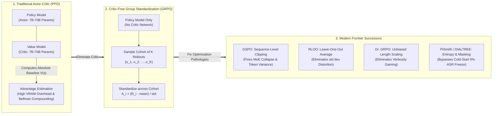
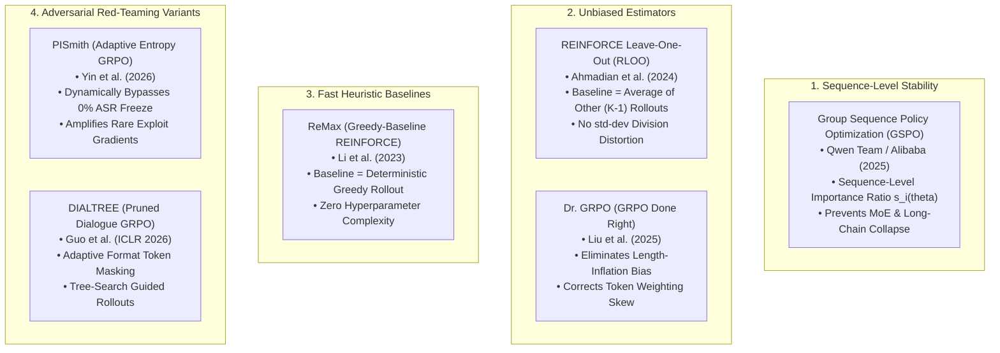
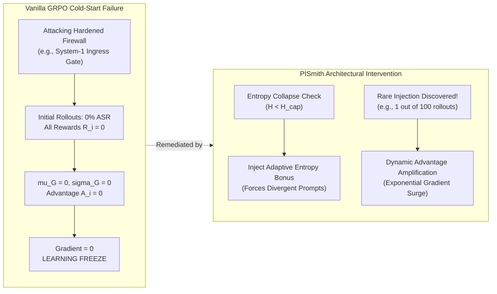
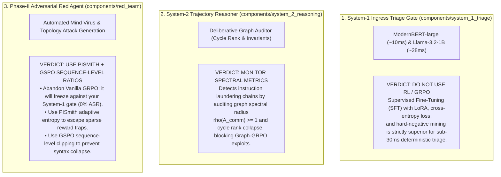

# PES UNIVERSITY
### Department of Computer Science and Engineering
**UE24CS320A – Capstone Project Phase – I**  
**Technical Research Report: Beyond Vanilla GRPO — In-Depth Analysis of Modern Critic-Free RL Alternatives and Advancements**

---

## 1. Project & Institutional Identification

| Field | Details |
| :--- | :--- |
| **Project Title** | **Adaptive Defense for Multi-Agent Systems** |
| **Document Type** | Advanced Algorithmic Research & Comparative Systems Report |
| **Component Focus** | [`components/red_team`](file:///home/student-14/capstone/components/red_team), [`components/system_1_triage`](file:///home/student-14/capstone/components/system_1_triage), [`components/system_2_reasoning`](file:///home/student-14/capstone/components/system_2_reasoning) |
| **Batch / Review** | Batch 14 (Review 1 Approved) |
| **Course Code** | UE24CS320A (Capstone Project Phase - I) |
| **Date** | November 2, 2026 |
| **Student Lead** | **Neel Chandrakar** (SRN: `PES2UG24CS310`) |
| **Team Members** | **Pranav Ballebail** (SRN: `PES2UG24CS361`) **Pranav Kaushal** (SRN: `PES2UG24CS363`) **Pranav Swaroop** (SRN: `PES2UG24CS365`) |
| **Institution** | Department of Computer Science & Engineering, PES University, Bengaluru |
| **Workstation Profile** | NVIDIA DGX Spark (`promaxgb10-7bf0`), NVIDIA GB10 GPU, ARM64 Ubuntu 24.04 LTS ([`.agent`](file:///home/student-14/.agent)) |
| **Direct Predecessor** | [`docs/05-reports/grpo_black_box_graph_attacks_report.md`](file:///home/student-14/capstone/docs/05-reports/grpo_black_box_graph_attacks_report.md) |
| **Target Integration** | Red Team Reinforcement Learning Suite ([`components/red_team/attacks`](file:///home/student-14/capstone/components/red_team/attacks)) & Topology Optimization Engine ([`components/red_team/topologies`](file:///home/student-14/capstone/components/red_team/topologies)) |

---

## 2. Executive Summary & Beginner's Conceptual Primer

### 2.1 Reinforcement Learning for Language Models in Plain English
In standard supervised fine-tuning (SFT), a model is taught via fixed demonstration pairs $(x, y)$: "given prompt $x$, predict exact target text $y$". This works well for simple style transfer or classification, but fails when teaching models to **reason**, **plan**, or **discover novel adversarial exploits**. In reasoning and attack scenarios, there are countless valid ways to solve a problem or construct an exploit, and static training labels cannot capture that breadth.

**Reinforcement Learning (RL)** changes the paradigm:
1. The model (the **Policy** $\pi_\theta$) generates multiple trial answers or actions (**Rollouts**).
2. A verification program or reward function assigns a score (**Reward** $R$) based on success or failure.
3. The training algorithm compares the score against a reference standard (**Advantage** $A$) and nudges the model's weights to make successful decisions more probable and failed decisions less probable.

### 2.2 Why GRPO Was Initially Revolutionary
Historically, **Proximal Policy Optimization (PPO)** dominated RLHF. PPO requires training two massive neural networks side-by-side: an **Actor** (generates tokens) and a **Critic** / Value Model $V_\psi(s)$ (predicts expected total reward from intermediate tokens).
* **The PPO Pathology:** The critic network requires equivalent parameter capacity to the actor. On consumer or edge infrastructure (and even enterprise GPU clusters), holding both models in memory consumes colossal VRAM. Furthermore, approximating value functions over discrete tokens causes **Bellman error compounding**, gradient variance spikes, and training instability.
* **DeepSeek's GRPO Breakthrough (2024/2025):** DeepSeek introduced **Group Relative Policy Optimization (GRPO)** in *DeepSeekMath* and *DeepSeek-R1*. GRPO eliminated the critic network entirely. Instead of using a critic model to predict a baseline, GRPO samples a cohort of $K$ completions for the same prompt, computes the empirical mean $\mu_G$ and standard deviation $\sigma_G$ of their scalar rewards, and uses that relative group performance as the advantage. This halved VRAM requirements and simplified post-training pipelines.

### 2.3 The "Dirty Secret": Why the Field Moved Beyond Vanilla GRPO
Despite its initial success, deploying vanilla GRPO across production reasoning models, long-context thinking agents, and adversarial red-teaming exposed deep algorithmic pathologies:
1. **Catastrophic Model Collapse on Long Reasoning Chains & MoEs:** GRPO applies *token-level* importance weighting and clipping using a *sequence-level* scalar advantage. On long outputs, this creates severe gradient variance that frequently causes irreversible training collapse.
2. **Cold-Start Gradient Starvation (Learning Freeze):** In adversarial red-teaming or hard security environments where baseline success is near zero (e.g., attacking a hardened ingress firewall), every rollout in the group fails ($R_i = 0$). As a result, $\mu_G = 0$ and $\sigma_G = 0$, causing the advantage $\hat{A}_i = 0$ and freezing all gradient updates.
3. **Length-Exploitation / Verbosity Bias:** Vanilla GRPO normalizes token gradients by sequence length $|o_i|$. Models quickly "game" this objective by bloating their reasoning traces with repetitive or hollow filler tokens to manipulate relative advantage.
4. **Syntax & Formatting Degeneration:** When a candidate rollout receives a negative relative advantage ($\hat{A}_i < 0$), vanilla GRPO penalizes every single token in the generation, including essential markdown delimiters, XML tags, and JSON schemas, resulting in structural syntax collapse.

This report conducts an exhaustive technical evaluation of the modern successor algorithms designed to solve these exact failure modes.

---

## 3. Mathematical Deconstruction of Traditional (Vanilla) GRPO

To understand why newer alternatives exist, we must first inspect the exact mathematics and mechanics of vanilla GRPO.

### 3.1 The Algorithmic Objective
Given an input prompt $q \sim \mathcal{D}$, the policy $\pi_{\theta_{\text{old}}}$ samples a cohort of $K$ candidate completions $\mathcal{O} = \{o_1, o_2, \dots, o_K\}$. A verifier or reward model computes scalar rewards $\mathcal{R} = \{R_1, R_2, \dots, R_K\}$.

#### 1. Cohort Advantage Standardization
$$\hat{A}_i = \frac{R_i - \mu_G}{\sigma_G + \delta}$$
$$\text{where } \mu_G = \frac{1}{K}\sum_{j=1}^K R_j, \quad \sigma_G = \sqrt{\frac{1}{K}\sum_{j=1}^K (R_j - \mu_G)^2}$$
where $\delta > 0$ (e.g., $10^{-6}$) is a small numerical stabilizer.

#### 2. Surrogate Clipped Objective with KL Penalty
$$\mathcal{J}_{\text{GRPO}}(\theta) = \mathbb{E}_{q \sim \mathcal{D}, \{o_i\}_{i=1}^K \sim \pi_{\theta_{\text{old}}}} \left[ \frac{1}{K}\sum_{i=1}^K \frac{1}{|o_i|}\sum_{t=1}^{|o_i|} \min \left( \rho_{i,t}(\theta)\hat{A}_i, \, \text{clip}(\rho_{i,t}(\theta), 1-\epsilon, 1+\epsilon)\hat{A}_i \right) - \beta \mathbb{D}_{\text{KL}}(\pi_\theta \parallel \pi_{\text{ref}}) \right]$$

where the per-token importance sampling ratio is:
$$\rho_{i,t}(\theta) = \frac{\pi_\theta(o_{i,t} \mid q, o_{i,<t})}{\pi_{\theta_{\text{old}}}(o_{i,t} \mid q, o_{i,<t})}$$
and the token-level KL divergence penalty against reference policy $\pi_{\text{ref}}$ is:
$$\mathbb{D}_{\text{KL}}(\pi_\theta \parallel \pi_{\text{ref}}) = \frac{\pi_{\text{ref}}(o_{i,t} \mid q, o_{i,<t})}{\pi_\theta(o_{i,t} \mid q, o_{i,<t})} - \log \left( \frac{\pi_{\text{ref}}(o_{i,t} \mid q, o_{i,<t})}{\pi_\theta(o_{i,t} \mid q, o_{i,<t})} \right) - 1$$

---

## 4. The Modern Successor Algorithms: In-Depth Breakdown

Below is a detailed technical analysis of the premier alternatives that have superseded or heavily patched vanilla GRPO across frontier research.

---

### 4.1 GSPO: Group Sequence Policy Optimization (Alibaba / Qwen Team)

#### Conceptual Overview
Introduced by the Alibaba Qwen team in mid-2025 to power the **Qwen3** reasoning series, **GSPO** is arguably the most mathematically significant evolution of GRPO. 

The Qwen team identified that GRPO's core mathematical flaw is an **aggregation mismatch**: the reward $R_i$ and advantage $\hat{A}_i$ are measured for the *entire response sequence*, but the probability ratio $\rho_{i,t}(\theta)$ and clipping operation are executed *per token*. When a model generates long chains of thought (e.g., 4,000+ tokens) or uses dynamic routing (Mixture-of-Experts), individual token ratios fluctuate wildly. Multiplying these noisy token ratios by a sequence-level advantage causes variance explosion, triggering catastrophic training collapse.

#### Mathematical Formulation
GSPO completely abandons per-token clipping. Instead, it computes a single **sequence-level importance sampling ratio** $s_i(\theta)$, geometrically normalized by the sequence length $|o_i|$:

$$s_i(\theta) = \left( \prod_{t=1}^{|o_i|} \frac{\pi_\theta(o_{i,t} \mid q, o_{i,<t})}{\pi_{\theta_{\text{old}}}(o_{i,t} \mid q, o_{i,<t})} \right)^{\frac{1}{|o_i|}} = \exp \left( \frac{1}{|o_i|} \sum_{t=1}^{|o_i|} \log \frac{\pi_\theta(o_{i,t} \mid q, o_{i,<t})}{\pi_{\theta_{\text{old}}}(o_{i,t} \mid q, o_{i,<t})} \right)$$

The GSPO surrogate objective applies clipping directly to this length-normalized sequence ratio:

$$\mathcal{J}_{\text{GSPO}}(\theta) = \mathbb{E}_{q \sim \mathcal{D}, \{o_i\}_{i=1}^K \sim \pi_{\theta_{\text{old}}}} \left[ \frac{1}{K}\sum_{i=1}^K \min \left( s_i(\theta)\hat{A}_i, \, \text{clip}(s_i(\theta), 1-\epsilon, 1+\epsilon)\hat{A}_i \right) - \beta \mathbb{D}_{\text{KL}}(\pi_\theta \parallel \pi_{\text{ref}}) \right]$$

#### Differences from Traditional GRPO
| Dimension | Traditional GRPO | Group Sequence Policy Optimization (GSPO) |
| :--- | :--- | :--- |
| **Clipping Level** | Token-by-token: clips $\rho_{i,t}(\theta)$ independently at each step. | Sequence-level: clips the geometric mean ratio $s_i(\theta)$ for the whole output. |
| **MoE Routing Stability** | Unstable; requires complex "Routing Replay" hacks to avoid expert collapse. | Highly stable; naturally accommodates dynamic routing across tokens. |
| **Long-Context Robustness** | Degrades over long reasoning traces ($>2\text{k}$ tokens). | Rock-solid stability over ultra-long trajectories ($>8\text{k}$ tokens). |
| **Gradient Variance** | High variance due to token-level ratio discrepancies. | Low variance; smoothed across the sequence manifold. |

---

### 4.2 RLOO: REINFORCE Leave-One-Out (Ahmadian et al.)

#### Conceptual Overview
While DeepSeek popularized GRPO, research teams at Cohere, Hugging Face, and academic labs frequently favor **RLOO**. RLOO is a critic-free policy gradient method rooted in classical Monte Carlo variance reduction.

The crucial intuition behind RLOO is identifying the hazard of GRPO's standard deviation denominator ($\sigma_G$). When sampling $K$ rollouts, if all candidates achieve nearly identical scores (e.g., rewards of $0.91, 0.92, 0.90$), $\sigma_G$ approaches zero. Dividing $(R_i - \mu_G)$ by $\sigma_G \to 0$ causes the advantage to blow up to massive values ($+10.0$ or $-10.0$), destabilizing policy updates. Conversely, when rewards are widely dispersed, updates shrink.

#### Mathematical Formulation
RLOO removes standard deviation division completely. For candidate completion $o_i$, the baseline is formulated strictly as the **mean of all other $K-1$ candidates in the cohort**, leaving candidate $i$ out:

$$\hat{A}_i^{\text{RLOO}} = R(o_i) - \frac{1}{K - 1}\sum_{j \neq i}^K R(o_j)$$

The policy gradient is computed as:
$$\nabla_\theta \mathcal{J}_{\text{RLOO}}(\theta) = \frac{1}{K}\sum_{i=1}^K \sum_{t=1}^{|o_i|} \nabla_\theta \log \pi_\theta(o_{i,t} \mid q, o_{i,<t}) \cdot \hat{A}_i^{\text{RLOO}}$$

Because candidate $o_i$ is excluded from its own baseline, the baseline is statistically independent of $o_i$. By the law of iterated expectations, this guarantees an **unbiased gradient estimator**:
$$\mathbb{E}_{o_i \sim \pi} \left[ \nabla_\theta \log \pi(o_i) \cdot \left( \frac{1}{K-1}\sum_{j \neq i} R(o_j) \right) \right] \equiv 0$$

#### Differences from Traditional GRPO
* **No Artificial Variance Scaling:** RLOO measures absolute margin differences ($R_i - \text{baseline}$), preserving the true physical scale of reward gains without distortion from $\sigma_G$.
* **Unbiased Baseline:** GRPO includes $R_i$ inside $\mu_G$, introducing a minor mathematical sample correlation; RLOO's leave-one-out baseline is strictly independent.
* **Simpler Implementation:** Bypasses numerical stability constants ($\delta$) and complex clipping schedules.

---

### 4.3 Dr. GRPO: Unbiased GRPO / GRPO Done Right (Liu et al., 2025)

#### Conceptual Overview
In the landmark paper *"Understanding R1-Zero-Like Training: A Critical Perspective"* ([arXiv:2503.20783](https://arxiv.org/abs/2503.20783)), researchers investigated why models trained with vanilla GRPO suffer from **length-bloating / verbosity bias**. 

When an LLM undergoes RLVR with vanilla GRPO, it quickly learns that generating longer answers correlates with higher advantage scores—even when the final answer is incorrect.

#### Mathematical Formulation & Root Cause
Vanilla GRPO scales the surrogate loss by $\frac{1}{|o_i|}$ (dividing by the token length of completion $i$):
$$\mathcal{L}_i = \frac{1}{|o_i|} \sum_{t=1}^{|o_i|} \min(\dots)$$

When candidate $o_i$ succeeds ($\hat{A}_i > 0$), dividing by $|o_i|$ *penalizes* long responses by shrinking the gradient update! Conversely, when candidate $o_j$ fails ($\hat{A}_j < 0$), dividing by $|o_j|$ causes longer failed responses to receive *smaller negative penalties* than short failed responses. Consequently, the model learns an exploitative behavioral shortcut: **if you are unsure or failing, output hundreds of rambling tokens to minimize the negative gradient update**.

**Dr. GRPO** resolves this by replacing token-length normalization with a global batch-constant scaling factor $L_{\text{norm}}$:
$$\mathcal{J}_{\text{Dr. GRPO}}(\theta) = \mathbb{E} \left[ \frac{1}{K}\sum_{i=1}^K \frac{1}{L_{\text{norm}}} \sum_{t=1}^{|o_i|} \min\left(\rho_{i,t}\hat{A}_i^{\text{unbiased}}, \, \text{clip}(\rho_{i,t}, 1-\epsilon, 1+\epsilon)\hat{A}_i^{\text{unbiased}}\right) \right]$$

#### Differences from Traditional GRPO
* **Neutralizes Verbosity Exploitation:** Eliminates the structural incentive for the model to pad incorrect answers with conversational filler.
* **Token Efficiency:** Produces reasoning models that reach equal or superior mathematical accuracy using $25\% - 40\%$ fewer generated tokens.

---

### 4.4 ReMax: Greedy-Baseline REINFORCE (Li et al.)

#### Conceptual Overview
**ReMax** was designed specifically around the unique characteristics of language models: fast generation, deterministic autoregressive transitions, and trajectory-level rewards. 

Instead of sampling a large group of $K = 8$ or $K = 16$ stochastic rollouts to compute cohort statistics, ReMax generates:
1. One stochastic rollout $o_{\text{stoch}} \sim \pi_\theta(\cdot \mid q)$ (temperature $T > 0$).
2. One deterministic greedy rollout $o_{\text{greedy}} \sim \arg\max \pi_\theta(\cdot \mid q)$ (temperature $T = 0$).

#### Mathematical Formulation
The deterministic greedy completion serves as the baseline:
$$\hat{A}_{\text{ReMax}} = R(o_{\text{stoch}}) - R(o_{\text{greedy}})$$

The policy gradient is:
$$\nabla_\theta \mathcal{J}_{\text{ReMax}} = \sum_{t=1}^{|o_{\text{stoch}}|} \nabla_\theta \log \pi_\theta(o_{\text{stoch}, t} \mid q, o_{\text{stoch}, <t}) \cdot \left( R(o_{\text{stoch}}) - R(o_{\text{greedy}}) \right)$$

#### Differences from Traditional GRPO
* **Drastic Query & Compute Savings:** GRPO requires sampling $K \ge 8$ rollouts per prompt to compute stable $\mu_G$ and $\sigma_G$. ReMax requires only **2 generations** (1 stochastic + 1 greedy argmax), reducing inference compute by up to $75\%$.
* **Zero Group Size Dependency:** Works efficiently even on batch sizes as small as 1, making it ideal for resource-constrained edge workstations (like single-GPU DGX setups).

---

### 4.5 Adversarial Red-Teaming Successors: PISmith & DIALTREE

When RL is applied to **automated adversarial red-teaming**—such as generating "Mind Virus" prompt injections or bypassing multi-agent security perimeters—vanilla GRPO fails completely due to domain-specific roadblocks.

#### 1. PISmith: Adaptive Entropy Regularization & Dynamic Advantage (Yin et al., 2026)
* **The Failure Mode in GRPO:** When training an adversarial red agent against a defended target (e.g., your System-1 triage gate), the baseline Attack Success Rate (ASR) is initially $0\%$. Since all candidates receive zero reward, $\sigma_G \to 0$ and advantages collapse to zero. The policy gradient vanishes ($\nabla_\theta \mathcal{J} = 0$), trapping the attacker in a permanent learning freeze.
* **The PISmith Solution:**
  1. **Adaptive Entropy Regularization:** Monitors the token distribution entropy $\mathcal{H}(\pi_\theta)$. Whenever entropy drops below a cap $\mathcal{H}_{\text{cap}}$ (signaling repetitive, uncreative prompt attempts), it injects an exploratory entropy bonus to force diverse perturbation strategies.
  2. **Dynamic Advantage Weighting:** When a rare rollout finally breaches the target defense, PISmith applies an amplified exponential advantage weight to that single successful rollout, ensuring the rare positive gradient breaks through the sea of zero rewards.

#### 2. DIALTREE: Tree-Search Dialogue-GRPO with Format Masking (Guo et al., ICLR 2026)
* **The Failure Mode in GRPO:** In multi-turn prompt injection attacks (such as Crescendo drift), candidate rollouts often fail initially, receiving $\hat{A}_i < 0$. Vanilla GRPO applies negative gradient updates uniformly across every token. Over successive iterations, this destroys the agent's basic language capabilities: the model begins generating malformed JSON, unclosed quotes, and broken delimiters.
* **The DIALTREE Solution:**
  * **Adaptive Format Masking:** Delineates conversational syntax and protocol delimiters from adversarial semantic payloads. When a rollout receives negative advantage, gradients on structural and syntactic tokens are masked to zero, ensuring the red agent maintains pristine formatting while updating only the semantic attack vector.

---

### 4.6 Graph-GRPO: Combinatorial Multi-Agent Topology Learning (Cang et al., 2026)

#### Conceptual Overview
As detailed in your technical report ([`docs/05-reports/grpo_black_box_graph_attacks_report.md`](file:///home/student-14/capstone/docs/05-reports/grpo_black_box_graph_attacks_report.md#L156-L173)), standard token-level RL cannot optimize discrete non-Euclidean graphs. 

When searching for optimal multi-agent communication networks or crafting topological black-box attacks, the action space is an adjacency matrix $A_{\text{comm}} \in \{0, 1\}^{M \times M}$. Classical actor-critic methods struggle because adding an intermediate edge provides zero immediate reward until the multi-agent task completes or fails.

#### Mechanics of Graph-GRPO
Graph-GRPO shifts the unit of generation from text tokens to an entire graph topology:
1. Conditioning on seed task $q$, policy $\pi_\theta$ generates a cohort of $K$ candidate communication routing graphs $\{A_1, A_2, \dots, A_K\}$.
2. The multi-agent swarm executes under each routing graph, measuring task success, token overhead, and epidemic infection depth.
3. Group advantage standardizes graph-level returns without noisy intermediate edge credit assignment.
4. **Spectral Stealth Constraints:** To prevent the policy from converging to trivial disconnected stars, the advantage objective integrates spectral radius penalties ($\rho(A_{\text{comm}}) < 1$) and degree Kolmogorov-Smirnov bounds ($D_{\text{KS}}$).

---

## 5. Comprehensive Comparative Matrix

The comparative matrix below maps traditional GRPO against all primary alternatives across critical architectural criteria:

| Algorithm | Critic Required? | Advantage Computation | Primary Optimization Level | VRAM Overhead | Long Reasoning / MoE Stability | Cold-Start (0% ASR) Resilience | Ideal Application Domain |
| :--- | :--- | :--- | :--- | :--- | :--- | :--- | :--- |
| **PPO** | **Yes** (Dedicated $V_\psi$) | Temporal GAE over states | Token-Level | Extreme ($2\times$ Actor) | Moderate (Prone to Bellman error) | Moderate | Legacy general chat alignment |
| **Vanilla GRPO** | **No** (Critic-free) | Cohort Normalization: $\frac{R_i - \mu_G}{\sigma_G + \delta}$ | Token-Level | **Low** (Policy + Ref only) | **Poor** (High token variance, collapse) | **Zero** (Freezes when $\sigma \to 0$) | Basic rule-based math/coding (DeepSeek-R1-Zero) |
| **GSPO** | **No** (Critic-free) | Group Normalization | **Sequence-Level** (Geometric Mean $s_i(\theta)$) | **Low** | **State-of-the-Art** (Zero MoE collapse) | Poor (Inherits group starvation) | Frontier reasoning models (Qwen3) & MoEs |
| **RLOO** | **No** (Critic-free) | Leave-One-Out Average: $R_i - \frac{1}{K-1}\sum_{j \neq i} R_j$ | Token or Sequence | **Low** | High (No $\sigma_G$ scaling distortion) | Low | Unbiased online RLHF & post-training |
| **Dr. GRPO** | **No** (Critic-free) | Unbiased constant length scaling ($1/L_{\text{norm}}$) | Token-Level | **Low** | High (Eliminates verbosity bias) | Low | Token-efficient reasoning models |
| **ReMax** | **No** (Critic-free) | Greedy Baseline: $R(o_{\text{stoch}}) - R(o_{\text{greedy}})$ | Trajectory-Level | **Ultra-Low** ($K=2$ rollouts) | Moderate | Low | Fast on-device tuning & small batch training |
| **PISmith** | **No** (Critic-free) | Adaptive Dynamic Weighting + Entropy Cap | Token or Sequence | **Low** | High | **State-of-the-Art** (Escapes 0% ASR traps) | Adversarial prompt injection & red-teaming |
| **DIALTREE** | **No** (Critic-free) | Pruned Group Advantage + Format Masking | Semantic Token-Level | Moderate (Tree search overhead) | High | Moderate | Multi-turn conversational red-teaming |
| **Graph-GRPO** | **No** (Critic-free) | Adjacency Cohort Standardization | Graph Topology ($A_{\text{comm}}$) | **Low** | High (Operates on discrete graphs) | Low | Multi-agent communication routing & attacks |

---

## 6. Synthesis: What This Means for Your Capstone Project

For your project, **Adaptive Defense for Multi-Agent Systems**, these algorithmic distinctions provide actionable guidance across your three core components:

### 6.1 Subsystem 1: System-1 Ingress Gate ([`components/system_1_triage`](file:///home/student-14/capstone/components/system_1_triage))
* **Should you use GRPO or an alternative here?** **No.**
* **Why:** Ingress triage requires fast, deterministic classification ($<10\text{ms}$ with ModernBERT, $<28\text{ms}$ with Llama-3.2-1B). RL optimization is intended for generative discovery and search, not calibrated boundary discrimination. As established in your overfitting remediation report ([`docs/05-reports/system1_overfitting_and_remediation_findings_report.md`](file:///home/student-14/capstone/docs/05-reports/system1_overfitting_and_remediation_findings_report.md)), supervised training with Stratified Group-Disjoint splitting and developer hard negatives achieves optimal latency and precision.

### 6.2 Subsystem 2: Phase-II Automated Red Agent ([`components/red_team/attacks`](file:///home/student-14/capstone/components/red_team/attacks))
* **Should you use Vanilla GRPO?** **Absolutely not.**
* **The Trap:** If you try to train an automated RL red agent using vanilla GRPO against your defended swarm, the System-1/System-2 defense will intercept $100\%$ of initial naive attacks ($R_0 \equiv 0.00$, as demonstrated in your benchmark report [`docs/05-reports/mind_virus_propagation_and_defense_benchmark_report.md`](file:///home/student-14/capstone/docs/05-reports/mind_virus_propagation_and_defense_benchmark_report.md)). All rollouts will receive $0$ reward, causing immediate gradient starvation and zero learning.
* **The Solution:** Adopt **PISmith's Adaptive Entropy Regularization** combined with **DIALTREE's Adaptive Format Masking**:
  1. Initialize with curriculum learning (attack an undefended baseline first, then transition to defended models).
  2. Inject an entropy bonus when policy exploration stalls.
  3. Mask formatting and XML tags when advantages are negative to keep the payload syntactically valid.

### 6.3 Subsystem 3: Multi-Agent Network Topology Optimization ([`components/red_team/topologies`](file:///home/student-14/capstone/components/red_team/topologies))
* **Algorithm Choice:** **Graph-GRPO with GSPO-style Sequence Normalization.**
* **Why:** Treating the agent communication matrix $A_{\text{comm}}$ as a cohesive cohort rollout bypasses the intractable multi-hop credit assignment problem. Couple this with sequence-level normalization to prevent optimization divergence across large swarms.

---

## 7. Actionable Implementation Checklist for Phase-II

When implementing reinforcement learning components for Phase-II:

- [ ] **Step 1: Replace $\sigma_G$ Division with RLOO Baseline for Baseline Experiments**
  - If using cohort sampling, implement $\hat{A}_i = R_i - \frac{1}{K-1}\sum_{j \neq i} R_j$ to avoid variance amplification when rewards are tightly clustered.
- [ ] **Step 2: Upgrade Token-Level Loss to GSPO Sequence Ratios**
  - In your PyTorch training loop, replace token-by-token clipping with length-normalized sequence likelihood ratios $s_i(\theta) = \exp\left(\frac{1}{|o_i|}\sum \log \frac{\pi_\theta}{\pi_{\text{old}}}\right)$.
- [ ] **Step 3: Integrate PISmith Entropy Caps in the Red Agent**
  - In [`components/red_team/attacks`](file:///home/student-14/capstone/components/red_team/attacks), track token entropy $\mathcal{H}_t = -\sum P \log P$. If $\mathcal{H}_t < \mathcal{H}_{\text{threshold}}$, add an exploration loss term $\mathcal{L}_{\text{ent}} = -\lambda_{\text{ent}} \mathcal{H}_t$ to prevent the red agent from repeating dead prompts.
- [ ] **Step 4: Implement Adaptive Format Masking**
  - Delineate template wrapper tokens (e.g., `[SYSTEM_SPEC]`, `[ROLE_TURN]`, `{"tool": ...}`) from free-form adversarial payloads. When $\hat{A}_i < 0$, zero out gradients on structural tokens.
- [ ] **Step 5: Enforce Spectral Constraints on Topological Attacks**
  - In [`components/red_team/topologies`](file:///home/student-14/capstone/components/red_team/topologies), compute the spectral radius $\rho(A_{\text{comm}})$ and Laplacian eigenvalue difference $\|\mathbf{\Lambda}(A_{\text{comm}}) - \mathbf{\Lambda}(A_0)\|_2$ inside the reward function to prevent collapse into trivial star graphs.

---

## 8. Systematic Bibliography & References

1. **Shao, Z., Wang, P., Zhu, Q., Xu, R., Song, J., Zhang, M., Zhang, Y., Wu, Y., & Guo, D.** (2024). *DeepSeekMath: Pushing the Limits of Mathematical Reasoning in Open Language Models*. arXiv:2402.03300. [arXiv Link](https://arxiv.org/pdf/2402.03300).
2. **DeepSeek-AI.** (2025). *DeepSeek-R1: Incentivizing Reasoning Capability in LLMs via Reinforcement Learning*. arXiv:2501.12948. [arXiv Link](https://arxiv.org/abs/2501.12948).
3. **Qwen Team, Alibaba Group.** (2025). *Group Sequence Policy Optimization (GSPO): Stabilizing Large Language Model Reinforcement Learning at Scale*. Technical Whitepaper & Qwen3 Release. [Qwen Research](https://qwen.ai).
4. **Ahmadian, A., Cremer, C., Gallagher, M., Fadaee, S., et al.** (2024). *Back to Basics: Revisiting REINFORCE Style Optimization for Language Model Alignment (RLOO)*. arXiv:2402.14740. [arXiv Link](https://arxiv.org/abs/2402.14740).
5. **Liu, T., et al.** (2025). *Understanding R1-Zero-Like Training: A Critical Perspective (Dr. GRPO)*. arXiv:2503.20783. [arXiv Link](https://arxiv.org/abs/2503.20783).
6. **Li, Z., Xu, T., Zhang, Y., et al.** (2023). *ReMax: A Simple, Effective, and Efficient Reinforcement Learning Method for Aligning Large Language Models*. arXiv:2310.10505. [arXiv Link](https://arxiv.org/abs/2310.10505).
7. **Yin, C., et al.** (2026). *PISmith: Reinforcement Learning-Based Red Teaming for Prompt Injection*. OpenReview & arXiv:2603.13026. [OpenReview Link](https://openreview.net/forum?id=tBmgvHPMVT).
8. **Guo, X., et al.** (2026). *DIALTREE: Tree-Based Dialogue Reinforced Policy Optimization for Red-Teaming*. International Conference on Learning Representations (ICLR 2026). [Penn CogComp PDF](https://cogcomp.seas.upenn.edu/papers/GOSBRR26.pdf).
9. **Cang, J., et al.** (2026). *Graph-GRPO: Stabilizing Multi-Agent Topology Learning via Group Relative Policy Optimization*. Findings of the Association for Computational Linguistics (ACL Findings 2026). [ACL Anthology](https://aclanthology.org/2026.findings-acl.1010/).
10. **Zhu, B., et al.** (2026). *Graph-GRPO: Training Graph Flow Models with Reinforcement Learning*. International Conference on Machine Learning (ICML 2026). [ResearchGate Link](https://www.researchgate.net/publication/401834657_Graph-GRPO_Training_Graph_Flow_Models_with_Reinforcement_Learning).
11. **Schulman, J., Wolski, F., Dhariwal, P., Radford, A., & Klimov, O.** (2017). *Proximal Policy Optimization Algorithms (PPO)*. arXiv:1707.06347. [arXiv Link](https://arxiv.org/abs/1707.06347).
12. **Rafailov, R., Sharma, A., Mitchell, E., Ermon, S., Manning, C. D., & Finn, C.** (2023). *Direct Preference Optimization: Your Language Model Is Secretly a Reward Model (DPO)*. NeurIPS 2023. [NeurIPS Link](https://proceedings.neurips.cc/paper_files/paper/2023/file/a85b405ed65c6477a4fe8302b5e06ce7-Paper-Conference.pdf).
