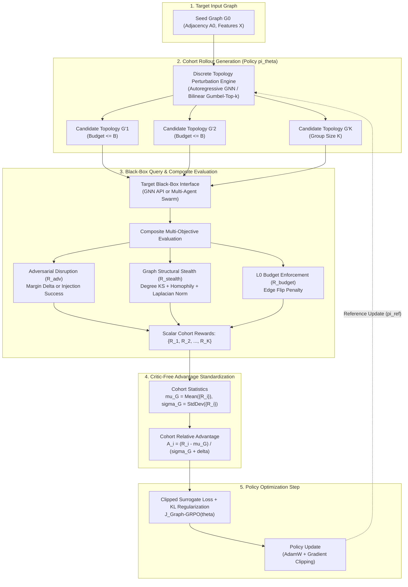

# PES UNIVERSITY
### Department of Computer Science and Engineering
**UE24CS320A – Capstone Project Phase – I**  
**Technical Research Report: Formulating Black-Box Graph Adversarial Attacks via Group Relative Policy Optimization (GRPO)**

---

## 1. Project & Institutional Identification

| Field | Details |
| :--- | :--- |
| **Project Title** | **Adaptive Defense for Multi-Agent Systems** |
| **Document Type** | Advanced Technical Research & Threat-Modeling Report |
| **Component Focus** | [`components/red_team`](file:///home/student-14/capstone/components/red_team), [`components/system_1_triage`](file:///home/student-14/capstone/components/system_1_triage), [`components/system_2_reasoning`](file:///home/student-14/capstone/components/system_2_reasoning) |
| **Batch / Review** | Batch 14 (Review 1 Approved) |
| **Course Code** | UE24CS320A (Capstone Project Phase - I) |
| **Date** | November 1, 2026 |
| **Student Lead** | **Neel Chandrakar** (SRN: `PES2UG24CS310`) |
| **Team Members** | **Pranav Ballebail** (SRN: `PES2UG24CS361`)<br/>**Pranav Kaushal** (SRN: `PES2UG24CS363`)<br/>**Pranav Swaroop** (SRN: `PES2UG24CS365`) |
| **Institution** | Department of Computer Science & Engineering, PES University, Bengaluru |
| **Workstation Profile** | NVIDIA DGX Spark (`promaxgb10-7bf0`), NVIDIA GB10 GPU, ARM64 Ubuntu 24.04 LTS ([`.agent`](file:///home/student-14/.agent)) |
| **Source Deep Research** | Google Gemini Deep Research Investigation (`https://gemini.google.com/share/6ea2d131cfa5`)<br/>Extracted Artifact: [`/tmp/GRPO_Black-Box_Graph_Attacks.md`](file:///tmp/GRPO_Black-Box_Graph_Attacks.md) |
| **Target Integration** | Red-Team Topology Attack Harness ([`components/red_team/topologies`](file:///home/student-14/capstone/components/red_team/topologies)) & Two-Tier Ingress Gate ([`components/system_1_triage`](file:///home/student-14/capstone/components/system_1_triage)) |

---

## 2. Executive Summary & Abstract

Adversarial machine learning on graph-structured architectures represents a fundamental open challenge within algorithmic security: the underlying search space is inherently discrete, non-Euclidean, and combinatorial [[1]](https://arxiv.org/pdf/1806.02371). While continuous gradient-based adversaries operate effectively across Euclidean inputs such as images or audio vectors, perturbing graph topologies—via discrete edge insertions, edge deletions, or node attribute rewiring—requires traversing an explosive combinatorial manifold [[1]](https://arxiv.org/pdf/1806.02371), [[2]](https://dl.acm.org/doi/fullHtml/10.1145/3366423.3380149). In realistic operational settings, adversaries operate strictly under black-box query restrictions: target weights, internal embeddings, and backpropagated gradients are completely hidden, with feedback restricted to class confidence scores, hard top-1 decision labels, or downstream multi-agent execution traces [[3]](https://pmc.ncbi.nlm.nih.gov/articles/PMC8409335/), [[4]](https://csis.gmu.edu/ksun/publications/Hard%20Label%20to%20GNN_CCS21.pdf), [[5]](https://cdn.aaai.org/ojs/20350/20350-13-24363-1-2-20220628.pdf).

Historically, reinforcement learning (RL) frameworks such as [`RL-S2V`](https://proceedings.mlr.press/v80/dai18b/dai18b.pdf) and actor-critic variants served as the dominant paradigm for learning query-efficient black-box graph attacks [[1]](https://arxiv.org/pdf/1806.02371), [[6]](https://proceedings.mlr.press/v80/dai18b/dai18b.pdf). However, traditional RL paradigms depend critically on parameterized value networks (critics) to approximate state-action values over combinatorial structures. These critic networks suffer severe empirical pathologies, including Bellman error compounding over non-smooth graph manifolds, catastrophic sample inefficiency, and gradient variance explosion under delayed, sparse terminal reward signals [[6]](https://proceedings.mlr.press/v80/dai18b/dai18b.pdf), [[7]](https://huggingface.co/buckets/nielsr/arxiv-chandra-ocr-full-markdown-20260406/tree/2003/2003.00653.md?code=true), [[8]](https://arxiv.org/pdf/2609.36816).

This research report analyzes the mathematical formulation and structural mechanics of translating **Group Relative Policy Optimization (GRPO)**—the critic-free RL algorithm popularized by DeepSeek for mathematical reasoning [[8]](https://arxiv.org/pdf/2609.36816), [[9]](https://arxiv.org/pdf/2402.03300)—into discrete non-Euclidean topological search spaces. By eliminating the parameterized value network ($V_\psi$) and substituting cohort-relative advantage standardization over groups of candidate perturbations, GRPO resolves longstanding bottlenecks in graph reinforcement learning.

Furthermore, this formulation bridges two crucial target horizons under a unified mathematical framework:
1. **Target A: Static Graph Neural Network (GNN) Prediction APIs** (e.g., node classification in financial fraud detection, molecular property screening, link prediction).
2. **Target B: Dynamic Multi-Agent System (MAS) Communication Graphs** (e.g., collaborative LLM agent swarms), where topological attacks manifest as *instruction laundering*, transitive trust subversion, and spectral consensus collapse ($\rho(A_{\text{comm}}) \ge 1$).



---

## 3. Discrete Black-Box Graph Adversarial Attacks

### 3.1 Mathematical Problem Formulation
In graph-structured learning, a target model maps an input graph $G = (\mathcal{V}, \mathcal{E})$ with node feature matrix $X \in \mathbb{R}^{|\mathcal{V}| \times d}$ and binary adjacency matrix $A \in \{0, 1\}^{|\mathcal{V}| \times |\mathcal{V}|}$ to predictions $f(G) \in \mathcal{Y}$ [[6]](https://proceedings.mlr.press/v80/dai18b/dai18b.pdf), [[7]](https://huggingface.co/buckets/nielsr/arxiv-chandra-ocr-full-markdown-20260406/tree/2003/2003.00653.md?code=true). An adversary operating under an $\ell_0$ perturbation budget $B$ seeks to construct a modified graph $G' = (\mathcal{V}', \mathcal{E}')$ by flipping edges ($\Delta A \in \{-1, 0, 1\}^{N \times N}$) such that:

$$\frac{1}{2}\|\Delta A\|_0 \le B \quad \text{and} \quad f(G') \neq f(G)$$

while preserving the underlying semantic invariants and structural imperceptibility of the topology [[4]](https://csis.gmu.edu/ksun/publications/Hard%20Label%20to%20GNN_CCS21.pdf), [[6]](https://proceedings.mlr.press/v80/dai18b/dai18b.pdf).

### 3.2 Taxonomy of Graph Attack Modalities

Graph adversarial attacks span a spectrum of operational assumptions regarding target model transparency, optimization strategy, and query feedback:

| Attack Modality | Model Access Level | Optimization Mechanism | Information Feedback | Representative Approaches | Core Structural Limitations |
| :--- | :--- | :--- | :--- | :--- | :--- |
| **Query-Based Soft-Label Evasion** | Black-box query access | Zeroth-order optimization, evolutionary search, policy gradients [[6]](https://proceedings.mlr.press/v80/dai18b/dai18b.pdf), [[7]](https://huggingface.co/buckets/nielsr/arxiv-chandra-ocr-full-markdown-20260406/tree/2003/2003.00653.md?code=true). | Continuous prediction probabilities $P(y \mid G')$ [[6]](https://proceedings.mlr.press/v80/dai18b/dai18b.pdf), [[7]](https://huggingface.co/buckets/nielsr/arxiv-chandra-ocr-full-markdown-20260406/tree/2003/2003.00653.md?code=true). | RL-S2V (soft setting), Genetic Algorithms [[1]](https://arxiv.org/pdf/1806.02371), [[6]](https://proceedings.mlr.press/v80/dai18b/dai18b.pdf). | Vulnerable to defensive confidence masking and query rate limits [[3]](https://pmc.ncbi.nlm.nih.gov/articles/PMC8409335/), [[4]](https://csis.gmu.edu/ksun/publications/Hard%20Label%20to%20GNN_CCS21.pdf). |
| **Query-Based Hard-Label Evasion** | Black-box query access | Combinatorial ray-searching, boundary distance approximation [[3]](https://pmc.ncbi.nlm.nih.gov/articles/PMC8409335/), [[4]](https://csis.gmu.edu/ksun/publications/Hard%20Label%20to%20GNN_CCS21.pdf). | Discrete decision label $\hat{y} \in \mathcal{Y}$ only [[3]](https://pmc.ncbi.nlm.nih.gov/articles/PMC8409335/), [[4]](https://csis.gmu.edu/ksun/publications/Hard%20Label%20to%20GNN_CCS21.pdf). | Hard-Label GNN Attack [[4]](https://csis.gmu.edu/ksun/publications/Hard%20Label%20to%20GNN_CCS21.pdf). | Extreme query complexity; high boundary variance [[4]](https://csis.gmu.edu/ksun/publications/Hard%20Label%20to%20GNN_CCS21.pdf). |
| **Transfer-Based Attacks** | Zero-query target access; surrogate access | Gradient sign methods (FGSM), Projected Gradient Descent (PGD) on surrogate [[2]](https://dl.acm.org/doi/fullHtml/10.1145/3366423.3380149), [[4]](https://csis.gmu.edu/ksun/publications/Hard%20Label%20to%20GNN_CCS21.pdf). | Surrogate gradients $\nabla_A \mathcal{L}_{\text{surr}}$ [[2]](https://dl.acm.org/doi/fullHtml/10.1145/3366423.3380149), [[4]](https://csis.gmu.edu/ksun/publications/Hard%20Label%20to%20GNN_CCS21.pdf). | Nettack, PGD topology transfer [[2]](https://dl.acm.org/doi/fullHtml/10.1145/3366423.3380149), [[4]](https://csis.gmu.edu/ksun/publications/Hard%20Label%20to%20GNN_CCS21.pdf). | Poor transferability across distinct message-passing architectures [[2]](https://dl.acm.org/doi/fullHtml/10.1145/3366423.3380149), [[5]](https://cdn.aaai.org/ojs/20350/20350-13-24363-1-2-20220628.pdf). |
| **Strict Zero-Query Attacks** | Zero-query target access; structural data only | Spectral filter perturbation, node centrality heuristics [[5]](https://cdn.aaai.org/ojs/20350/20350-13-24363-1-2-20220628.pdf), [[14]](https://arxiv.org/pdf/2012.06757). | None (unsupervised topology metrics) [[5]](https://cdn.aaai.org/ojs/20350/20350-13-24363-1-2-20220628.pdf). | STACK [[5]](https://cdn.aaai.org/ojs/20350/20350-13-24363-1-2-20220628.pdf), [[14]](https://arxiv.org/pdf/2012.06757). | Suboptimal against adversarially trained or non-spectral GNN models [[5]](https://cdn.aaai.org/ojs/20350/20350-13-24363-1-2-20220628.pdf), [[14]](https://arxiv.org/pdf/2012.06757). |
| **Sequential Reinforcement Learning** | Black-box query access | Markov Decision Process (MDP), Q-learning, Actor-Critic [[1]](https://arxiv.org/pdf/1806.02371), [[6]](https://proceedings.mlr.press/v80/dai18b/dai18b.pdf). | Scalar target loss margin or terminal binary reward [[6]](https://proceedings.mlr.press/v80/dai18b/dai18b.pdf), [[15]](https://arxiv.org/html/2302.07363v3). | RL-S2V [[1]](https://arxiv.org/pdf/1806.02371), [[6]](https://proceedings.mlr.press/v80/dai18b/dai18b.pdf). | Critic overestimation bias, credit assignment failure, sample inefficiency [[6]](https://proceedings.mlr.press/v80/dai18b/dai18b.pdf), [[16]](https://www.researchgate.net/publication/401178707_HieraMAS_Optimizing_Intra-Node_LLM_Mixtures_and_Inter-Node_Topology_for_Multi-Agent_Systems). |

### 3.3 Combinatorial Search Spaces and the Credit Assignment Bottleneck
In a graph with $N = |\mathcal{V}|$ nodes, the discrete action space of potential edge modifications scales as $\mathcal{O}(N^2)$ [[1]](https://arxiv.org/pdf/1806.02371), [[6]](https://proceedings.mlr.press/v80/dai18b/dai18b.pdf). Under an edge budget $B$, an adversary must search over a combinatorial space of size:

$$\binom{\frac{N(N-1)}{2}}{B}$$

Sequential RL frameworks decompose this search into a sequence of hierarchical edge selection steps:

$$a_t = (u_t, v_t) \sim \pi(u \mid s_t) \cdot \pi(v \mid u_t, s_t)$$

where node $u_t$ is selected first, and node $v_t$ is selected conditioned on $u_t$ [[1]](https://arxiv.org/pdf/1806.02371), [[6]](https://proceedings.mlr.press/v80/dai18b/dai18b.pdf).

The fundamental theoretical bottleneck in this setup is the **credit assignment problem** [[16]](https://www.researchgate.net/publication/401178707_HieraMAS_Optimizing_Intra-Node_LLM_Mixtures_and_Inter-Node_Topology_for_Multi-Agent_Systems). Spatial GNNs aggregate features across $K$-hop neighborhoods:

$$h_v^{(k)} = \text{UPDATE}^{(k)} \left( h_v^{(k-1)}, \text{AGGREGATE}^{(k)} \left( \left\{ h_u^{(k-1)} : u \in \mathcal{N}(v) \right\} \right) \right)$$

Modifying an intermediate edge $(u_t, v_t)$ at step $t < B$ alters localized spectral properties incrementally without triggering an immediate label flip [[5]](https://cdn.aaai.org/ojs/20350/20350-13-24363-1-2-20220628.pdf), [[17]](https://arxiv.org/html/2603.04474v2). Consequently, rewards are strictly zero for all intermediate steps:

$$r(s_t, a_t) = 0 \quad \forall t < B$$

Terminal feedback is provided only at step $t = B$. Distributing this terminal scalar across intermediate edges $\tau = (a_1, a_2, \dots, a_B)$ constitutes an intractable attribution dilemma: benign or redundant edge flips are reinforced simply because they co-occur within a successful rollout [[6]](https://proceedings.mlr.press/v80/dai18b/dai18b.pdf), [[16]](https://www.researchgate.net/publication/401178707_HieraMAS_Optimizing_Intra-Node_LLM_Mixtures_and_Inter-Node_Topology_for_Multi-Agent_Systems).

### 3.4 Pathologies of Classical Critic-Based RL on Graphs
When classical actor-critic algorithms (such as PPO or DQN) are applied to discrete graph rewiring, three structural failures arise:
1. **Bellman Error Compounding over Non-Lipschitz Landscapes:** Graph topologies exhibit discrete, step-function loss surfaces [[5]](https://cdn.aaai.org/ojs/20350/20350-13-24363-1-2-20220628.pdf), [[18]](https://medium.com/@lyraclaude20/every-agent-framework-picks-a-topology-none-of-them-know-why-6465fc434577). Deleting a single critical bridge edge can cause the classification loss to spike sharply, whereas deleting any peripheral edge yields zero effect. Parameterized value networks $V_\psi(s)$ cannot fit this non-smooth landscape, producing massive temporal difference errors ($\delta_t = r_t + \gamma V_\psi(s_{t+1}) - V_\psi(s_t)$) and destabilizing policy updates [[6]](https://proceedings.mlr.press/v80/dai18b/dai18b.pdf), [[8]](https://arxiv.org/pdf/2609.36816).
2. **Terminal Sparse Reward Starvation:** In an $\mathcal{O}(N^2)$ action space over horizon $B$, the probability of discovering an effective terminal trajectory through random exploration scales inversely with graph size, causing policy gradient starvation [[6]](https://proceedings.mlr.press/v80/dai18b/dai18b.pdf), [[19]](https://arxiv.org/html/2609.33628v1).
3. **Query Explosion under Rate Caps:** Training an actor-critic agent requires millions of environment interactions to converge [[19]](https://arxiv.org/html/2609.33628v1), [[20]](https://openreview.net/forum?id=tBmgvHPMVT&referrer=%5Bthe%20profile%20of%20Chenlong%20Yin%5D(%2Fprofile%3Fid%3D~Chenlong_Yin1)). Deployed graph APIs enforce strict rate limits (e.g., 60 RPM) and billing thresholds, rendering classical TD-learning completely impractical [[3]](https://pmc.ncbi.nlm.nih.gov/articles/PMC8409335/), [[4]](https://csis.gmu.edu/ksun/publications/Hard%20Label%20to%20GNN_CCS21.pdf).

---

## 4. Group Relative Policy Optimization on Structured Topologies

### 4.1 Algorithmic Foundations: PPO vs. GRPO
Standard Proximal Policy Optimization (PPO) maximizes a clipped surrogate objective regularized by Generalized Advantage Estimation (GAE) [[8]](https://arxiv.org/pdf/2609.36816), [[10]](https://www.scribd.com/document/963612461/2512-07611v1):

$$\mathcal{J}_{\text{PPO}}(\theta) = \hat{\mathbb{E}}_t \left[ \min\left( \rho_t(\theta)\hat{A}_t^{\text{GAE}}, \, \text{clip}(\rho_t(\theta), 1-\epsilon, 1+\epsilon)\hat{A}_t^{\text{GAE}} \right) \right]$$

where $\rho_t(\theta) = \frac{\pi_\theta(a_t \mid s_t)}{\pi_{\theta_{\text{old}}}(a_t \mid s_t)}$ and $\hat{A}_t^{\text{GAE}} = \sum_{l=0}^\infty (\gamma \lambda)^l \delta_{t+l}^V$ is heavily dependent on a critic network $V_\psi(s)$.

**Group Relative Policy Optimization (GRPO)** eliminates $V_\psi(s)$ entirely [[8]](https://arxiv.org/pdf/2609.36816), [[9]](https://arxiv.org/pdf/2402.03300), [[10]](https://www.scribd.com/document/963612461/2512-07611v1). For each input instance $q \sim \mathcal{D}$ (e.g., seed graph $G_0$), the policy $\pi_{\theta_{\text{old}}}$ samples a cohort of $G$ distinct candidate completions $\{o_1, o_2, \dots, o_G\}$. A reward oracle evaluates each candidate to yield scalar returns $\{R_1, R_2, \dots, R_G\}$. The advantage $\hat{A}_i$ for candidate $o_i$ is computed by standardizing its reward against the cohort statistics [[8]](https://arxiv.org/pdf/2609.36816), [[21]](https://arxiv.org/pdf/2602.09000):

$$\hat{A}_i = \frac{R_i - \text{mean}\left(\{R_1, \dots, R_G\}\right)}{\text{std}\left(\{R_1, \dots, R_G\}\right) + \delta}$$

where $\delta > 0$ provides numerical stabilization. The policy optimization objective is:

$$\mathcal{J}_{\text{GRPO}}(\theta) = \mathbb{E}_{q \sim \mathcal{D}, \{o_i\}_{i=1}^G \sim \pi_{\theta_{\text{old}}}} \left[ \frac{1}{G}\sum_{i=1}^G \frac{1}{|o_i|}\sum_{t=1}^{|o_i|} \min \left( \rho_{i,t}(\theta)\hat{A}_i, \, \text{clip}(\rho_{i,t}(\theta), 1-\epsilon, 1+\epsilon)\hat{A}_i \right) - \beta \mathbb{D}_{\text{KL}}(\pi_\theta \parallel \pi_{\text{ref}}) \right]$$

with an unbiased, non-negative token-level Kullback-Leibler divergence penalty [[8]](https://arxiv.org/pdf/2609.36816), [[10]](https://www.scribd.com/document/963612461/2512-07611v1), [[21]](https://arxiv.org/pdf/2602.09000):

$$\mathbb{D}_{\text{KL}}(\pi_\theta \parallel \pi_{\text{ref}}) = \frac{\pi_{\text{ref}}(o_{i,t} \mid q, o_{i,<t})}{\pi_\theta(o_{i,t} \mid q, o_{i,<t})} - \log \left( \frac{\pi_{\text{ref}}(o_{i,t} \mid q, o_{i,<t})}{\pi_\theta(o_{i,t} \mid q, o_{i,<t})} \right) - 1$$

| Dimension | Proximal Policy Optimization (PPO) | Group Relative Policy Optimization (GRPO) |
| :--- | :--- | :--- |
| **Critic Network** | Requires dedicated parameterized $V_\psi(s)$ [[8]](https://arxiv.org/pdf/2609.36816), [[10]](https://www.scribd.com/document/963612461/2512-07611v1). | **Eliminated completely** [[8]](https://arxiv.org/pdf/2609.36816), [[9]](https://arxiv.org/pdf/2402.03300), [[10]](https://www.scribd.com/document/963612461/2512-07611v1). |
| **Advantage Estimation** | Temporal GAE over sequential transitions [[8]](https://arxiv.org/pdf/2609.36816), [[10]](https://www.scribd.com/document/963612461/2512-07611v1). | Empirical cohort standardization ($\mu_G, \sigma_G$) [[8]](https://arxiv.org/pdf/2609.36816), [[21]](https://arxiv.org/pdf/2602.09000). |
| **VRAM Footprint** | High; holds actor and critic models concurrently [[8]](https://arxiv.org/pdf/2609.36816), [[10]](https://www.scribd.com/document/963612461/2512-07611v1). | **Minimal**; memory reserved solely for policy and reference forward passes [[8]](https://arxiv.org/pdf/2609.36816). |
| **Baseline Normalization** | Absolute baseline parameterized by $V_\psi(s_t)$ [[8]](https://arxiv.org/pdf/2609.36816), [[22]](https://www.osti.gov/servlets/purl/3375199). | Relative cohort baseline per seed instance [[8]](https://arxiv.org/pdf/2609.36816), [[22]](https://www.osti.gov/servlets/purl/3375199). |
| **Regularization** | Implicit clip / entropy bonus [[8]](https://arxiv.org/pdf/2609.36816), [[10]](https://www.scribd.com/document/963612461/2512-07611v1). | Explicit step-level KL penalty against $\pi_{\text{ref}}$ [[8]](https://arxiv.org/pdf/2609.36816), [[10]](https://www.scribd.com/document/963612461/2512-07611v1). |

### 4.2 Cross-Domain Extensions to Structured Topologies
The structural simplicity and variance reduction properties of GRPO have catalyzed recent breakthrough adaptations outside linear NLP:
1. **Multi-Agent Topology Optimization (Graph-GRPO):** Cang et al. [[12]](https://aclanthology.org/2026.findings-acl.1010/) formulate cooperative communication topology learning via GRPO. For each problem query $q$, the policy samples a cohort of discrete communication routing matrices $A_{\text{comm}}$. The swarm executes under each topology, and GRPO standardizes downstream performance to identify optimal communication topologies and cycle properties without noisy per-edge credit attribution [[12]](https://aclanthology.org/2026.findings-acl.1010/), [[18]](https://medium.com/@lyraclaude20/every-agent-framework-picks-a-topology-none-of-them-know-why-6465fc434577), [[23]](https://huggingface.co/papers/2603.02701).
2. **Generative Graph Flow Alignment (Flow-GRPO):** Zhu et al. [[11]](https://www.researchgate.net/publication/401834657_Graph-GRPO_Training_Graph_Flow_Models_with_Reinforcement_Learning), [[24]](https://openreview.net/forum?id=Abko94Sl7D), [[25]](https://arxiv.org/abs/2603.10395), [[26]](https://github.com/Zhubaoheng/Graph-GRPO) apply GRPO over discrete graph flow denoising trajectories (DeFoG backbone). By deriving an analytic rate matrix, group advantages align structural molecular properties (e.g., binding affinity, planarity) across 23 PMO benchmarks with state-of-the-art results.
3. **Conversational Tree-Search Red-Teaming (DIALTREE):** Guo et al. [[13]](https://cogcomp.seas.upenn.edu/papers/GOSBRR26.pdf), [[27]](https://openreview.net/forum?id=El37o7iBjX), [[28]](https://arxiv.org/abs/2510.02286) integrate tree search with Dialogue-GRPO. Crucially, they introduce **adaptive format masking**: when a rollout yields negative relative advantage ($\hat{A}_i < 0$), gradients on syntax and formatting tokens are masked to prevent structural degeneration of the adversarial prompt.
4. **Adversarial Prompt Injection (PISmith & RL-Hammer):** Yin et al. [[20]](https://openreview.net/forum?id=tBmgvHPMVT&referrer=%5Bthe%20profile%20of%20Chenlong%20Yin%5D(%2Fprofile%3Fid%3D~Chenlong_Yin1)), [[30]](https://arxiv.org/html/2603.13026v2) and Wen et al. [[29]](https://arxiv.org/pdf/2510.04885) leverage GRPO to bypass hardened prompt injection defenses (Meta-SecAlign-8B, Instruction Hierarchy). PISmith introduces **adaptive entropy regularization** (activating an exploration bonus when policy uncertainty collapses below $\mathcal{H}_{\text{cap}}$) and **dynamic advantage weighting** to escape sparse reward traps [[20]](https://openreview.net/forum?id=tBmgvHPMVT&referrer=%5Bthe%20profile%20of%20Chenlong%20Yin%5D(%2Fprofile%3Fid%3D~Chenlong_Yin1)), [[30]](https://arxiv.org/html/2603.13026v2), [[33]](https://www.researchgate.net/figure/Training-dynamics-of-Standard-GRPO-vs-PISmith-against-Meta-SecAlign-8B-a-Standard_fig1_402148811).

### 4.3 Cohort Normalization vs. Step-Level GAE
Step-level Generalized Advantage Estimation (GAE) decomposes trajectory returns into additive sequential steps:

$$\hat{A}_t^{\text{GAE}} = \delta_t + \gamma \lambda \delta_{t+1} + \dots$$

This assumption breaks fundamentally on combinatorial graphs [[6]](https://proceedings.mlr.press/v80/dai18b/dai18b.pdf), [[16]](https://www.researchgate.net/publication/401178707_HieraMAS_Optimizing_Intra-Node_LLM_Mixtures_and_Inter-Node_Topology_for_Multi-Agent_Systems). An edge flip $e_1$ may exert zero adversarial impact in isolation, but produce an immediate classification failure when paired with edge $e_2$ (e.g., establishing a 2-hop bypass around a defensive node bottleneck) [[16]](https://www.researchgate.net/publication/401178707_HieraMAS_Optimizing_Intra-Node_LLM_Mixtures_and_Inter-Node_Topology_for_Multi-Agent_Systems), [[17]](https://arxiv.org/html/2603.04474v2). 

In contrast, GRPO treats the entire structural mutation:

$$G'_i = G_0 \oplus \Delta E_i$$

as a cohesive action [[12]](https://aclanthology.org/2026.findings-acl.1010/), [[16]](https://www.researchgate.net/publication/401178707_HieraMAS_Optimizing_Intra-Node_LLM_Mixtures_and_Inter-Node_Topology_for_Multi-Agent_Systems). By sampling a group of $K$ candidate perturbed graphs $\{G'_1, \dots, G'_K\}$ conditioned on seed graph $G_0$, GRPO standardizes rewards relative to the structural cohort average [[8]](https://arxiv.org/pdf/2609.36816), [[12]](https://aclanthology.org/2026.findings-acl.1010/). This baseline subtraction eliminates the intrinsic difficulty of the underlying graph instance $G_0$—some graphs are naturally more robust than others—allowing the policy gradient to isolate perturbations that outperform the cohort average [[8]](https://arxiv.org/pdf/2609.36816), [[12]](https://aclanthology.org/2026.findings-acl.1010/), [[22]](https://www.osti.gov/servlets/purl/3375199).

---

## 5. Systematic Literature Matrix

The comparative matrix below maps foundational and modern literature across graph attacks, critic-free reinforcement learning, and structural red-teaming:

| Reference & Venue | Setting & Threat Model | Target Model & Modality | Optimization Method | Advantage Mechanism | Core Strengths | Key Vulnerabilities & Limitations |
| :--- | :--- | :--- | :--- | :--- | :--- | :--- |
| **RL-S2V**<br>Dai et al.<br>*ICML 2018* [[6]](https://proceedings.mlr.press/v80/dai18b/dai18b.pdf) | Black-box query evasion / poisoning; budget $\|\Delta E\|_0 \le m$ [[1]](https://arxiv.org/pdf/1806.02371), [[6]](https://proceedings.mlr.press/v80/dai18b/dai18b.pdf). | Node & graph classification (GCN, GraphSAGE) [[1]](https://arxiv.org/pdf/1806.02371), [[6]](https://proceedings.mlr.press/v80/dai18b/dai18b.pdf). | Q-learning with Structure2Vec embedding [[1]](https://arxiv.org/pdf/1806.02371), [[6]](https://proceedings.mlr.press/v80/dai18b/dai18b.pdf). | Hierarchical Bellman TD error $\delta_t = r + \gamma \max Q - Q$ [[1]](https://arxiv.org/pdf/1806.02371), [[6]](https://proceedings.mlr.press/v80/dai18b/dai18b.pdf). | First formalization of graph attacks as discrete MDPs; generalizes to unseen graphs [[6]](https://proceedings.mlr.press/v80/dai18b/dai18b.pdf), [[7]](https://huggingface.co/buckets/nielsr/arxiv-chandra-ocr-full-markdown-20260406/tree/2003/2003.00653.md?code=true). | Severe sample inefficiency; critic overestimation; sparse terminal reward collapse [[6]](https://proceedings.mlr.press/v80/dai18b/dai18b.pdf), [[7]](https://huggingface.co/buckets/nielsr/arxiv-chandra-ocr-full-markdown-20260406/tree/2003/2003.00653.md?code=true). |
| **STACK**<br>Xu et al.<br>*AAAI 2022* [[5]](https://cdn.aaai.org/ojs/20350/20350-13-24363-1-2-20220628.pdf), [[14]](https://arxiv.org/pdf/2012.06757) | Strict zero-query black-box; no target feedback [[5]](https://cdn.aaai.org/ojs/20350/20350-13-24363-1-2-20220628.pdf), [[14]](https://arxiv.org/pdf/2012.06757). | Node classification across diverse GNN architectures [[5]](https://cdn.aaai.org/ojs/20350/20350-13-24363-1-2-20220628.pdf), [[14]](https://arxiv.org/pdf/2012.06757). | Gradient-free spectral filter perturbation [[5]](https://cdn.aaai.org/ojs/20350/20350-13-24363-1-2-20220628.pdf), [[14]](https://arxiv.org/pdf/2012.06757). | None (Deterministic graph-theoretic heuristics) [[5]](https://cdn.aaai.org/ojs/20350/20350-13-24363-1-2-20220628.pdf). | Zero query overhead; completely circumvents black-box detection and rate limits [[5]](https://cdn.aaai.org/ojs/20350/20350-13-24363-1-2-20220628.pdf). | Suboptimal against adversarially trained or non-spectral GNN defenses; lacks task adaptivity [[5]](https://cdn.aaai.org/ojs/20350/20350-13-24363-1-2-20220628.pdf), [[14]](https://arxiv.org/pdf/2012.06757). |
| **DeepSeekMath**<br>Shao et al.<br>*arXiv 2024* [[9]](https://arxiv.org/pdf/2402.03300) | Generative sequence modeling / mathematical reasoning [[8]](https://arxiv.org/pdf/2609.36816), [[9]](https://arxiv.org/pdf/2402.03300). | Autoregressive LLMs (DeepSeek-7B) [[8]](https://arxiv.org/pdf/2609.36816), [[9]](https://arxiv.org/pdf/2402.03300). | Group Relative Policy Optimization (GRPO) [[8]](https://arxiv.org/pdf/2609.36816), [[9]](https://arxiv.org/pdf/2402.03300). | Cohort normalization: $\hat{A}_i = \frac{R_i - \mu_{\{R\}}}{\sigma_{\{R\}} + \delta}$ [[8]](https://arxiv.org/pdf/2609.36816), [[21]](https://arxiv.org/pdf/2602.09000). | Eliminates critic network; cuts memory footprint; stabilizes policy updates [[8]](https://arxiv.org/pdf/2609.36816), [[10]](https://www.scribd.com/document/963612461/2512-07611v1). | Prone to entropy collapse and reward hacking under unregularized binary rewards [[10]](https://www.scribd.com/document/963612461/2512-07611v1), [[20]](https://openreview.net/forum?id=tBmgvHPMVT&referrer=%5Bthe%20profile%20of%20Chenlong%20Yin%5D(%2Fprofile%3Fid%3D~Chenlong_Yin1)), [[30]](https://arxiv.org/html/2603.13026v2). |
| **Graph-GRPO**<br>Cang et al.<br>*ACL Findings 2026* [[12]](https://aclanthology.org/2026.findings-acl.1010/) | Cooperative Multi-Agent Systems; communication topology search [[12]](https://aclanthology.org/2026.findings-acl.1010/). | LLM-based agent swarms (reasoning & code generation) [[12]](https://aclanthology.org/2026.findings-acl.1010/), [[23]](https://huggingface.co/papers/2603.02701). | GRPO over discrete agent communication graphs [[12]](https://aclanthology.org/2026.findings-acl.1010/). | Group-relative advantage over candidate communication graphs [[12]](https://aclanthology.org/2026.findings-acl.1010/). | Solves per-edge credit assignment in multi-agent systems; optimizes cycle rank [[12]](https://aclanthology.org/2026.findings-acl.1010/), [[18]](https://medium.com/@lyraclaude20/every-agent-framework-picks-a-topology-none-of-them-know-why-6465fc434577). | Evaluated primarily on cooperative rather than adversarial settings; relies on static group sizes [[12]](https://aclanthology.org/2026.findings-acl.1010/). |
| **Graph-GRPO Flow**<br>Zhu et al.<br>*ICML 2026* [[11]](https://www.researchgate.net/publication/401834657_Graph-GRPO_Training_Graph_Flow_Models_with_Reinforcement_Learning), [[25]](https://arxiv.org/abs/2603.10395) | Generative graph flow alignment under verifiable rewards [[11]](https://www.researchgate.net/publication/401834657_Graph-GRPO_Training_Graph_Flow_Models_with_Reinforcement_Learning), [[24]](https://openreview.net/forum?id=Abko94Sl7D). | Discrete Graph Flow Models (DeFoG backbone) [[11]](https://www.researchgate.net/publication/401834657_Graph-GRPO_Training_Graph_Flow_Models_with_Reinforcement_Learning), [[24]](https://openreview.net/forum?id=Abko94Sl7D), [[26]](https://github.com/Zhubaoheng/Graph-GRPO). | Flow-GRPO with analytic transition rate matrices [[11]](https://www.researchgate.net/publication/401834657_Graph-GRPO_Training_Graph_Flow_Models_with_Reinforcement_Learning), [[24]](https://openreview.net/forum?id=Abko94Sl7D), [[26]](https://github.com/Zhubaoheng/Graph-GRPO). | Trajectory-level group advantage on molecular properties [[11]](https://www.researchgate.net/publication/401834657_Graph-GRPO_Training_Graph_Flow_Models_with_Reinforcement_Learning), [[24]](https://openreview.net/forum?id=Abko94Sl7D). | Differentiable transition probabilities; high structural validity on molecular oracles [[11]](https://www.researchgate.net/publication/401834657_Graph-GRPO_Training_Graph_Flow_Models_with_Reinforcement_Learning), [[24]](https://openreview.net/forum?id=Abko94Sl7D), [[26]](https://github.com/Zhubaoheng/Graph-GRPO). | Requires complex analytic rate formulations; high compute during iterative refinement [[24]](https://openreview.net/forum?id=Abko94Sl7D), [[26]](https://github.com/Zhubaoheng/Graph-GRPO). |
| **DIALTREE**<br>Guo et al.<br>*ICLR 2026* [[13]](https://cogcomp.seas.upenn.edu/papers/GOSBRR26.pdf), [[28]](https://arxiv.org/abs/2510.02286) | Multi-turn conversational black-box red-teaming [[13]](https://cogcomp.seas.upenn.edu/papers/GOSBRR26.pdf), [[27]](https://openreview.net/forum?id=El37o7iBjX). | Conversational LLMs (12 target commercial models) [[13]](https://cogcomp.seas.upenn.edu/papers/GOSBRR26.pdf), [[27]](https://openreview.net/forum?id=El37o7iBjX). | Tree-search Dialogue-GRPO with pruning [[13]](https://cogcomp.seas.upenn.edu/papers/GOSBRR26.pdf), [[28]](https://arxiv.org/abs/2510.02286). | Group advantage over pruned dialogue tree rollouts [[13]](https://cogcomp.seas.upenn.edu/papers/GOSBRR26.pdf), [[27]](https://openreview.net/forum?id=El37o7iBjX). | Discovers multi-step strategic jailbreaks; adaptive format masking prevents syntax decay [[13]](https://cogcomp.seas.upenn.edu/papers/GOSBRR26.pdf), [[27]](https://openreview.net/forum?id=El37o7iBjX). | High query fan-out across tree branches; limited to conversational input spaces [[13]](https://cogcomp.seas.upenn.edu/papers/GOSBRR26.pdf), [[27]](https://openreview.net/forum?id=El37o7iBjX). |
| **RL-Hammer**<br>Wen et al.<br>*Preprint 2025/2026* [[29]](https://arxiv.org/pdf/2510.04885) | Automated prompt injection against agentic workflows [[29]](https://arxiv.org/pdf/2510.04885). | Defended LLM agents (SecAlign, Instruction Hierarchy) [[29]](https://arxiv.org/pdf/2510.04885). | On-policy GRPO without warm-up demonstrations [[29]](https://arxiv.org/pdf/2510.04885). | Relative advantage over injection candidate batches [[29]](https://arxiv.org/pdf/2510.04885). | Achieves high ASR on frontier targets without curated demonstration sets [[29]](https://arxiv.org/pdf/2510.04885). | Struggles when attacking hardened frontier targets from a cold start (0% ASR initial signal) [[20]](https://openreview.net/forum?id=tBmgvHPMVT&referrer=%5Bthe%20profile%20of%20Chenlong%20Yin%5D(%2Fprofile%3Fid%3D~Chenlong_Yin1)), [[31]](https://arxiv.org/pdf/2609.33628). |
| **PISmith**<br>Yin et al.<br>*Preprint 2026* [[20]](https://openreview.net/forum?id=tBmgvHPMVT&referrer=%5Bthe%20profile%20of%20Chenlong%20Yin%5D(%2Fprofile%3Fid%3D~Chenlong_Yin1)), [[32]](https://arxiv.org/catchup/cs.LG/2026-07-24?abs=True&page=1) | Black-box prompt injection red-teaming under extreme defense [[20]](https://openreview.net/forum?id=tBmgvHPMVT&referrer=%5Bthe%20profile%20of%20Chenlong%20Yin%5D(%2Fprofile%3Fid%3D~Chenlong_Yin1)), [[32]](https://arxiv.org/catchup/cs.LG/2026-07-24?abs=True&page=1). | LLM agents & frontier targets (GPT-5-nano, SecAlign-8B) [[19]](https://arxiv.org/html/2609.33628v1), [[20]](https://openreview.net/forum?id=tBmgvHPMVT&referrer=%5Bthe%20profile%20of%20Chenlong%20Yin%5D(%2Fprofile%3Fid%3D~Chenlong_Yin1)). | GRPO with Adaptive Entropy & Dynamic Advantage [[20]](https://openreview.net/forum?id=tBmgvHPMVT&referrer=%5Bthe%20profile%20of%20Chenlong%20Yin%5D(%2Fprofile%3Fid%3D~Chenlong_Yin1)), [[30]](https://arxiv.org/html/2603.13026v2). | Reward-conditioned entropy and amplified advantage for rare successes [[20]](https://openreview.net/forum?id=tBmgvHPMVT&referrer=%5Bthe%20profile%20of%20Chenlong%20Yin%5D(%2Fprofile%3Fid%3D~Chenlong_Yin1)), [[30]](https://arxiv.org/html/2603.13026v2). | Prevents entropy collapse; turns near-zero baseline ASR into high success [[20]](https://openreview.net/forum?id=tBmgvHPMVT&referrer=%5Bthe%20profile%20of%20Chenlong%20Yin%5D(%2Fprofile%3Fid%3D~Chenlong_Yin1)), [[30]](https://arxiv.org/html/2603.13026v2), [[33]](https://www.researchgate.net/figure/Training-dynamics-of-Standard-GRPO-vs-PISmith-against-Meta-SecAlign-8B-a-Standard_fig1_402148811). | Requires hyperparameter tuning of entropy caps and reward thresholds [[20]](https://openreview.net/forum?id=tBmgvHPMVT&referrer=%5Bthe%20profile%20of%20Chenlong%20Yin%5D(%2Fprofile%3Fid%3D~Chenlong_Yin1)), [[30]](https://arxiv.org/html/2603.13026v2). |

---

## 6. Mathematical Framework & Policy Formulation

### 6.1 Action Parameterization Regimes
Let $G_0 = (\mathcal{V}, \mathcal{E}_0)$ be the seed graph with adjacency $A_0 \in \{0, 1\}^{N \times N}$ and node feature matrix $X \in \mathbb{R}^{N \times d}$. The attacker generates a perturbed adjacency matrix $A' = A_0 \oplus \Delta A$ subject to budget $\frac{1}{2}\|\Delta A\|_0 \le B$ [[4]](https://csis.gmu.edu/ksun/publications/Hard%20Label%20to%20GNN_CCS21.pdf), [[6]](https://proceedings.mlr.press/v80/dai18b/dai18b.pdf).

Two parameterization architectures can parameterize this policy:

#### 1. Autoregressive Regime
The policy sequentially samples $B$ discrete edge flips $\tau = (a_1, a_2, \dots, a_B)$ with $a_t = (u_t, v_t)$ [[1]](https://arxiv.org/pdf/1806.02371), [[6]](https://proceedings.mlr.press/v80/dai18b/dai18b.pdf). At step $t$, a Graph Transformer or GNN encodes the intermediate topology into node latents:

$$H^{(t-1)} = \text{GNN}_\theta(A^{(t-1)}, X)$$

The edge probability factors hierarchically:

$$\pi_\theta(a_t \mid G^{(t-1)}) = \pi_\theta(u_t \mid G^{(t-1)}) \cdot \pi_\theta(v_t \mid u_t, G^{(t-1)})$$

This formulation matches the sequential decision structure of [`RL-S2V`](https://proceedings.mlr.press/v80/dai18b/dai18b.pdf) while leveraging critic-free cohort standardization [[6]](https://proceedings.mlr.press/v80/dai18b/dai18b.pdf), [[12]](https://aclanthology.org/2026.findings-acl.1010/).

#### 2. One-Shot Bilinear Head Regime
The policy evaluates all candidate node pairs simultaneously [[12]](https://aclanthology.org/2026.findings-acl.1010/), [[16]](https://www.researchgate.net/publication/401178707_HieraMAS_Optimizing_Intra-Node_LLM_Mixtures_and_Inter-Node_Topology_for_Multi-Agent_Systems). An encoder computes node representations $h_u, h_v \in \mathbb{R}^{d_{\text{latent}}}$, and a bilinear scoring head parameterizes the edge distribution:

$$S_{uv} = \frac{h_u^\top W_\theta h_v}{\sqrt{d_{\text{latent}}}}, \quad P((u, v) \in \mathcal{E}') = \sigma(S_{uv})$$

Candidate perturbed graphs are sampled via Gumbel-Top-$k$ sampling or Bernoulli sampling with budget projection [[4]](https://csis.gmu.edu/ksun/publications/Hard%20Label%20to%20GNN_CCS21.pdf), [[12]](https://aclanthology.org/2026.findings-acl.1010/).

### 6.2 Composite Multi-Objective Reward
To guarantee that the learned attack satisfies operational imperceptibility and budget constraints while maximizing adversarial disruption, the scalar return $R(G'_i)$ is decomposed into three distinct objectives [[4]](https://csis.gmu.edu/ksun/publications/Hard%20Label%20to%20GNN_CCS21.pdf), [[5]](https://cdn.aaai.org/ojs/20350/20350-13-24363-1-2-20220628.pdf), [[6]](https://proceedings.mlr.press/v80/dai18b/dai18b.pdf):

$$R(G'_i) = \mathcal{R}_{\text{adv}}(G'_i) + \mathcal{R}_{\text{stealth}}(G'_i) + \mathcal{R}_{\text{budget}}(G'_i)$$

#### Objective 1: Adversarial Success Margin ($\mathcal{R}_{\text{adv}}$)
Depending on API feedback granularity [[3]](https://pmc.ncbi.nlm.nih.gov/articles/PMC8409335/), [[4]](https://csis.gmu.edu/ksun/publications/Hard%20Label%20to%20GNN_CCS21.pdf), [[6]](https://proceedings.mlr.press/v80/dai18b/dai18b.pdf):
* **Soft-Label Confidence Vectors:** Let $f_c(G')$ denote the target classifier's probability for class $c$, and $y$ denote the ground-truth label:
  $$\mathcal{R}_{\text{adv}}(G'_i) = \max_{c \neq y} f_c(G'_i) - f_y(G'_i)$$
  This continuous margin provides informative gradient signals even prior to a discrete classification label flip [[6]](https://proceedings.mlr.press/v80/dai18b/dai18b.pdf), [[7]](https://huggingface.co/buckets/nielsr/arxiv-chandra-ocr-full-markdown-20260406/tree/2003/2003.00653.md?code=true).
* **Hard-Label Outputs Only:**
  $$\mathcal{R}_{\text{adv}}(G'_i) = \begin{cases} +1.0 & \text{if } f(G'_i) \neq y \\ -1.0 & \text{if } f(G'_i) = y \end{cases}$$

#### Objective 2: Structural Imperceptibility & Graph Stealth ($\mathcal{R}_{\text{stealth}}$)
Naive graph attacks alter topological invariants, making them trivially detectable by graph sanitization layers (e.g., SVD filtering or homophily audits) [[4]](https://csis.gmu.edu/ksun/publications/Hard%20Label%20to%20GNN_CCS21.pdf), [[34]](https://kth.diva-portal.org/smash/get/diva2:2049659/FULLTEXT01.pdf). The stealth reward penalizes deviations across three fundamental graph-theoretic distributions:

$$\mathcal{R}_{\text{stealth}}(G'_i) = -\lambda_{\text{deg}} D_{\text{KS}}(\mathcal{D}(G'_i), \mathcal{D}(G_0)) - \lambda_{\text{hom}} |\mathcal{H}(G'_i) - \mathcal{H}(G_0)| - \lambda_{\text{spec}} \|\mathbf{\Lambda}(G'_i) - \mathbf{\Lambda}(G_0)\|_2$$

1. **Degree Kolmogorov-Smirnov Distance ($D_{\text{KS}}$):** Measures deviations in the cumulative node degree distribution, penalizing artificial hub creation [[5]](https://cdn.aaai.org/ojs/20350/20350-13-24363-1-2-20220628.pdf).
2. **Edge Homophily Preservation ($\mathcal{H}$):** Defined as $\mathcal{H}(G) = \frac{\sum_{(u, v) \in \mathcal{E}} \mathbb{I}(y_u = y_v)}{|\mathcal{E}|}$. Prevents the attacker from adding conspicuous inter-class edges that drop community cohesion [[5]](https://cdn.aaai.org/ojs/20350/20350-13-24363-1-2-20220628.pdf), [[34]](https://kth.diva-portal.org/smash/get/diva2:2049659/FULLTEXT01.pdf).
3. **Laplacian Spectral Perturbation ($\mathbf{\Lambda}$):** Compares the top-$k$ eigenvalues of the normalized graph Laplacian $\tilde{L} = I - D^{-1/2} A D^{-1/2}$, preserving the graph's global spectral filter characteristics and evading low-rank matrix approximation defenses [[4]](https://csis.gmu.edu/ksun/publications/Hard%20Label%20to%20GNN_CCS21.pdf), [[5]](https://cdn.aaai.org/ojs/20350/20350-13-24363-1-2-20220628.pdf).

#### Objective 3: Strict Perturbation Budget Penalty ($\mathcal{R}_{\text{budget}}$)
To enforce the operational edge flip cap $B$:

$$\mathcal{R}_{\text{budget}}(G'_i) = -\alpha \max\left(0, \, \frac{1}{2}\|A'_i - A_0\|_0 - B\right)$$

where $\alpha \gg 0$ ensures budget violations yield a net negative return [[6]](https://proceedings.mlr.press/v80/dai18b/dai18b.pdf).

### 6.3 Group Relative Advantage & Degenerate Minima Suppression
Given $K$ sampled candidate graphs $\{G'_1, \dots, G'_K\}$ conditioned on seed graph $G_0$, relative advantages are standardized [[8]](https://arxiv.org/pdf/2609.36816), [[12]](https://aclanthology.org/2026.findings-acl.1010/):

$$\hat{A}_i = \frac{R(G'_i) - \mu_G}{\sigma_G + \delta}, \quad \mu_G = \frac{1}{K}\sum_{j=1}^K R(G'_j), \quad \sigma_G = \sqrt{\frac{1}{K}\sum_{j=1}^K \left( R(G'_j) - \mu_G \right)^2}$$

This standardization establishes an automated **self-policing mechanism against degenerate topological local minima** [[8]](https://arxiv.org/pdf/2609.36816), [[12]](https://aclanthology.org/2026.findings-acl.1010/):
* A notorious failure mode in unconstrained graph attacks is **topological isolation**: the agent induces misclassification simply by cutting all incident edges to the target node, isolating it completely [[7]](https://huggingface.co/buckets/nielsr/arxiv-chandra-ocr-full-markdown-20260406/tree/2003/2003.00653.md?code=true).
* While this trivial modification maximizes $\mathcal{R}_{\text{adv}}$, it incurs an extreme penalty from $\mathcal{R}_{\text{stealth}}$ due to the degree distribution shift and Laplacian eigenvalue distortion [[4]](https://csis.gmu.edu/ksun/publications/Hard%20Label%20to%20GNN_CCS21.pdf), [[5]](https://cdn.aaai.org/ojs/20350/20350-13-24363-1-2-20220628.pdf).
* As a result, $R(G'_i) \ll \mu_G$, forcing $\hat{A}_i < 0$. Because GRPO clips and suppresses negative-advantage updates, the policy actively down-weights degenerate disconnection strategies relative to stealthy topological rewiring [[8]](https://arxiv.org/pdf/2609.36816), [[13]](https://cogcomp.seas.upenn.edu/papers/GOSBRR26.pdf).

### 6.4 Full Clipped Surrogate Loss with KL Regularization
The complete training objective integrates the clipped surrogate loss, group advantage, and an explicit Kullback-Leibler penalty against reference policy $\pi_{\text{ref}}$ [[8]](https://arxiv.org/pdf/2609.36816), [[21]](https://arxiv.org/pdf/2602.09000):

$$\mathcal{J}_{\text{Graph-GRPO}}(\theta) = \mathbb{E}_{G_0 \sim \mathcal{D}, \{G'_i\}_{i=1}^K \sim \pi_{\theta_{\text{old}}}} \left[ \frac{1}{K}\sum_{i=1}^K \min \left( \rho_i(\theta)\hat{A}_i, \, \text{clip}(\rho_i(\theta), 1-\epsilon, 1+\epsilon)\hat{A}_i \right) - \beta \mathbb{D}_{\text{KL}}(\pi_\theta(G'_i \mid G_0) \parallel \pi_{\text{ref}}(G'_i \mid G_0)) \right]$$

where the importance weight ratio across edge decision steps $a_t \in \Delta E_i$ is given by:

$$\rho_i(\theta) = \prod_{t=1}^{|\Delta E_i|} \frac{\pi_\theta(a_t \mid G^{(t-1)})}{\pi_{\theta_{\text{old}}}(a_t \mid G^{(t-1)})}$$

and the KL divergence penalty prevents the policy from drifting into erratic generative spaces, preserving structural stability throughout optimization [[8]](https://arxiv.org/pdf/2609.36816), [[10]](https://www.scribd.com/document/963612461/2512-07611v1), [[13]](https://cogcomp.seas.upenn.edu/papers/GOSBRR26.pdf).

---

## 7. Algorithmic Execution Pipeline

The algorithmic loop below implements the critic-free training process for the black-box graph adversary, executing cohort rollout generation, parallel black-box querying, advantage standardization, and clipped policy updates:

```python
# Algorithmic Training Loop: GRPO Black-Box Graph Adversary
# Hyperparameters: Group size K, Clip epsilon, KL coeff beta, Budget B, Learning rate eta

Initialize policy network pi_theta (Graph Transformer / GNN)
Initialize reference policy pi_ref = copy(pi_theta)
Initialize optimizer AdamW(pi_theta.parameters(), lr=eta)

for iteration in 1, ..., MaxIterations:
    # 1. Sample batch of seed graphs from target distribution
    Batch_G0 = SampleBatch(GraphDataset, batch_size=M)
    
    for G0 in Batch_G0:
        # 2. Rollout phase: generate cohort of candidate perturbed graphs
        Candidates = []
        with no_grad():
            for i in 1, ..., K:
                # Sample discrete perturbations up to budget B under current policy
                Delta_E_i = SampleActions(pi_theta, G0, budget=B)
                G_prime_i = ApplyPerturbation(G0, Delta_E_i)
                Candidates.append((G_prime_i, Delta_E_i))
        
        # 3. Parallel Black-Box API Evaluation
        # Query target model API concurrently across cohort to compute returns
        Rewards = []
        for (G_prime_i, Delta_E_i) in Candidates:
            L_blackbox = QueryBlackBoxAPI(G_prime_i)
            R_adv = ComputeAdversarialMargin(L_blackbox)
            R_stealth = ComputeStealthPenalty(G_prime_i, G0) # Degree KS, Homophily, Laplacian
            R_budget = ComputeBudgetPenalty(Delta_E_i, max_budget=B)
            
            Total_R = R_adv + R_stealth + R_budget
            Rewards.append(Total_R)
            
        # 4. Group Advantage Computation
        mu_group = Mean(Rewards)
        sigma_group = StdDev(Rewards) + 1e-8
        Advantages = [(r - mu_group) / sigma_group for r in Rewards]
        
        # 5. Policy Optimization Step (Critic-Free Update)
        optimizer.zero_grad()
        Loss = 0.0
        
        for i in 1, ..., K:
            (G_prime_i, Delta_E_i) = Candidates[i]
            A_i = Advantages[i]
            
            # Compute likelihood ratios over sequential edge decisions
            log_prob_curr = pi_theta.EvaluateLogProb(Delta_E_i, G0)
            log_prob_old  = log_prob_curr.detach()
            ratio = exp(log_prob_curr - log_prob_old)
            
            # Clipped surrogate objective
            surr1 = ratio * A_i
            surr2 = clamp(ratio, 1.0 - epsilon, 1.0 + epsilon) * A_i
            policy_loss = -min(surr1, surr2)
            
            # Unbiased token/edge-level KL regularization against reference policy
            log_prob_ref = pi_ref.EvaluateLogProb(Delta_E_i, G0)
            kl_div = exp(log_prob_ref - log_prob_curr) - (log_prob_ref - log_prob_curr) - 1.0
            
            Loss += (policy_loss + beta * kl_div) / K
            
        # Backpropagate and update policy weights
        Loss.backward()
        ClipGradients(pi_theta.parameters(), max_norm=1.0)
        optimizer.step()
        
    # Periodic update of reference weights
    if iteration % UpdateInterval == 0:
        pi_ref = copy(pi_theta)
```

---

## 8. Dual Target Horizons: Static GNN Classifiers and Dynamic Multi-Agent Networks

The GRPO graph attack formulation generalizes across two primary architectures: static Graph Neural Network prediction endpoints and dynamic Multi-Agent System (MAS) communication graphs [[6]](https://proceedings.mlr.press/v80/dai18b/dai18b.pdf), [[12]](https://aclanthology.org/2026.findings-acl.1010/), [[18]](https://medium.com/@lyraclaude20/every-agent-framework-picks-a-topology-none-of-them-know-why-6465fc434577). While both exhibit graph-structured dependency representations, their state spaces, vulnerability profiles, and failure manifestations diverge significantly [[7]](https://huggingface.co/buckets/nielsr/arxiv-chandra-ocr-full-markdown-20260406/tree/2003/2003.00653.md?code=true), [[17]](https://arxiv.org/html/2603.04474v2):

| System Dimension | Target A: Static GNN Prediction APIs | Target B: Dynamic Multi-Agent Networks |
| :--- | :--- | :--- |
| **Topological Representation** | Binary adjacency matrix $A \in \{0, 1\}^{N \times N}$ over data nodes [[6]](https://proceedings.mlr.press/v80/dai18b/dai18b.pdf), [[7]](https://huggingface.co/buckets/nielsr/arxiv-chandra-ocr-full-markdown-20260406/tree/2003/2003.00653.md?code=true). | Communication routing matrix $A_{\text{comm}} \in \{0, 1\}^{M \times M}$ over autonomous LLM agents [[12]](https://aclanthology.org/2026.findings-acl.1010/), [[17]](https://arxiv.org/html/2603.04474v2). |
| **Node Semantics** | Static continuous entity features $x_v \in \mathbb{R}^d$ (e.g., text embeddings, chemical tokens) [[1]](https://arxiv.org/pdf/1806.02371), [[6]](https://proceedings.mlr.press/v80/dai18b/dai18b.pdf). | Autonomous LLM agents with conversational memory, system instructions, and tool access [[18]](https://medium.com/@lyraclaude20/every-agent-framework-picks-a-topology-none-of-them-know-why-6465fc434577), [[35]](https://iosec.in/multi-agent-prompt-injection-llm-security/). |
| **Information Propagation** | Deterministic neural message passing (spatial aggregation / GNN layers) [[6]](https://proceedings.mlr.press/v80/dai18b/dai18b.pdf), [[7]](https://huggingface.co/buckets/nielsr/arxiv-chandra-ocr-full-markdown-20260406/tree/2003/2003.00653.md?code=true). | Asynchronous natural language dialogue, structured JSON tool calls, and context forwarding [[17]](https://arxiv.org/html/2603.04474v2), [[35]](https://iosec.in/multi-agent-prompt-injection-llm-security/). |
| **Adversarial Failure Mode** | Misclassification of node label, erroneous link prediction, or wrong graph label [[4]](https://csis.gmu.edu/ksun/publications/Hard%20Label%20to%20GNN_CCS21.pdf), [[6]](https://proceedings.mlr.press/v80/dai18b/dai18b.pdf). | Cascading prompt injection, unauthorized tool execution, consensus deadlocks, instruction laundering [[17]](https://arxiv.org/html/2603.04474v2), [[18]](https://medium.com/@lyraclaude20/every-agent-framework-picks-a-topology-none-of-them-know-why-6465fc434577), [[35]](https://iosec.in/multi-agent-prompt-injection-llm-security/). |
| **Query Feedback Mechanism** | Continuous confidence scores or discrete top-1 predicted labels [[3]](https://pmc.ncbi.nlm.nih.gov/articles/PMC8409335/), [[4]](https://csis.gmu.edu/ksun/publications/Hard%20Label%20to%20GNN_CCS21.pdf). | Multi-agent execution traces, sandbox logs, tool outputs, and downstream text answers [[20]](https://openreview.net/forum?id=tBmgvHPMVT&referrer=%5Bthe%20profile%20of%20Chenlong%20Yin%5D(%2Fprofile%3Fid%3D~Chenlong_Yin1)), [[29]](https://arxiv.org/pdf/2510.04885). |

### 8.1 Target A: Static GNN APIs
In commercial GNN endpoints (credit fraud detection, molecular screening, recommendation engines), the target model executes spatial message passing over fixed graphs [[6]](https://proceedings.mlr.press/v80/dai18b/dai18b.pdf), [[11]](https://www.researchgate.net/publication/401834657_Graph-GRPO_Training_Graph_Flow_Models_with_Reinforcement_Learning). Attackers operate under strict query caps ($Q_{\text{max}} \le 1,000$). GRPO optimizes within this budget by sampling compact cohort sizes ($K \in [4, 8]$), maintaining exploration efficiency without requiring millions of queries to train an internal critic [[8]](https://arxiv.org/pdf/2609.36816), [[21]](https://arxiv.org/pdf/2602.09000). Attack vectors include:
* **Node Classification Evasion:** Perturbing 2-hop neighbor edges around high-value nodes to trigger label flips without modifying node attributes [[2]](https://dl.acm.org/doi/fullHtml/10.1145/3366423.3380149), [[6]](https://proceedings.mlr.press/v80/dai18b/dai18b.pdf).
* **Link Prediction Disruption:** Inserting deceptive structural bridges between disparate communities to collapse recommendation heuristics [[5]](https://cdn.aaai.org/ojs/20350/20350-13-24363-1-2-20220628.pdf), [[7]](https://huggingface.co/buckets/nielsr/arxiv-chandra-ocr-full-markdown-20260406/tree/2003/2003.00653.md?code=true).
* **Graph Classification Poisoning:** Inserting dense motifs or high-betweenness cliques to flip graph-level property predictions [[4]](https://csis.gmu.edu/ksun/publications/Hard%20Label%20to%20GNN_CCS21.pdf), [[6]](https://proceedings.mlr.press/v80/dai18b/dai18b.pdf).

### 8.2 Target B: Multi-Agent Systems, Instruction Laundering, and Spectral Dynamics
Modern enterprise architectures deploy collaborative multi-agent ecosystems (e.g., AutoGen, MetaGPT, ChatDev, Magentic-One), where autonomous LLM instances collaborate across directed communication graphs $\mathcal{G}_{\text{comm}} = (\mathcal{V}_{\text{agent}}, \mathcal{E}_{\text{comm}})$ [[18]](https://medium.com/@lyraclaude20/every-agent-framework-picks-a-topology-none-of-them-know-why-6465fc434577), [[36]](https://www.researchgate.net/publication/408353083_Graph-GRPO_Stabilizing_Multi-Agent_Topology_Learning_via_Group_Relative_Policy_Optimization). Perturbing this topology alters the propagation of instructions and context, exposing systemic security vulnerabilities [[17]](https://arxiv.org/html/2603.04474v2), [[18]](https://medium.com/@lyraclaude20/every-agent-framework-picks-a-topology-none-of-them-know-why-6465fc434577).

#### 1. The Instruction Laundering Mechanism
In single-agent settings, prompt injection is bounded by the model's context window [[35]](https://iosec.in/multi-agent-prompt-injection-llm-security/). Multi-agent networks, however, operate under **transitive trust invariants**: downstream execution agents (e.g., terminal code executors or database query agents) implicitly trust inputs received from internal planner or summarizer agents [[17]](https://arxiv.org/html/2603.04474v2), [[35]](https://iosec.in/multi-agent-prompt-injection-llm-security/). 

When an adversary modifies the communication topology—routing untrusted external inputs through intermediate benign agents before reaching the executive orchestrator—an **instruction laundering** chain occurs [[35]](https://iosec.in/multi-agent-prompt-injection-llm-security/). The injected payload is sequentially summarized, normalized, and repackaged by intermediate agents, systematically stripping away adversarial stylistic flags while preserving the malicious operational directive [[17]](https://arxiv.org/html/2603.04474v2), [[35]](https://iosec.in/multi-agent-prompt-injection-llm-security/).

#### 2. Spectral Dynamics of Consensus Collapse
Information diffusion and injection spread across multi-agent networks adhere to non-linear propagation dynamics [[17]](https://arxiv.org/html/2603.04474v2). The susceptibility of an agent network to belief corruption or injection diffusion depends on the **spectral radius** $\rho(A_{\text{comm}})$ of the communication adjacency matrix:

$$\rho(A_{\text{comm}}) = \max_i |\lambda_i(A_{\text{comm}})|$$

When $\rho(A_{\text{comm}}) \ge 1$, errors and injected instructions do not dissipate; they amplify across iterative conversational turns [[17]](https://arxiv.org/html/2603.04474v2). Furthermore, empirical research demonstrates that the **directed cycle count (cycle rank)** of an agent topology is strongly predictive of population homogenization and system collapse [[18]](https://medium.com/@lyraclaude20/every-agent-framework-picks-a-topology-none-of-them-know-why-6465fc434577). High cycle counts reduce agent diversity ($r = -0.68$, $\eta^2 = 0.24$), creating feedback loops that trap agents in consensus deadlocks or self-amplifying hallucinations [[18]](https://medium.com/@lyraclaude20/every-agent-framework-picks-a-topology-none-of-them-know-why-6465fc434577).

#### 3. MAS Red-Teaming Reward Formulation
Using GRPO, an adversary optimizes the communication graph to maximize injection propagation [[12]](https://aclanthology.org/2026.findings-acl.1010/), [[29]](https://arxiv.org/pdf/2510.04885). By inserting communication edges between untrusted sensor agents and high-centrality orchestrators, or introducing cyclic routing to trap verification agents in infinite loops, the attacker drives the system toward compromise [[17]](https://arxiv.org/html/2603.04474v2), [[18]](https://medium.com/@lyraclaude20/every-agent-framework-picks-a-topology-none-of-them-know-why-6465fc434577). Formulating rewards via execution tracing on agentic benchmarks (such as InjecAgent and AgentDojo) allows GRPO to isolate configurations that bypass tool sandboxes with minimal communication overhead [[8]](https://arxiv.org/pdf/2609.36816), [[12]](https://aclanthology.org/2026.findings-acl.1010/), [[29]](https://arxiv.org/pdf/2510.04885), [[35]](https://iosec.in/multi-agent-prompt-injection-llm-security/):

$$\mathcal{R}_{\text{MAS}} = \mathbb{I}(\text{Unauthorized Tool Call Executed}) - \gamma \cdot \text{TokenCost}$$

---

## 9. Empirical Benchmarks, Failure Modes, and Defensive Feasibility

### 9.1 Empirical Failure Modes and Remediation

#### Failure Mode 1: Reward Hacking & Trivial Star Topologies
In unconstrained optimization, the policy exploits blind spots in the reward formulation [[30]](https://arxiv.org/html/2603.13026v2). If the spectral stealth penalty $\lambda_{\text{spec}}$ is weighted too low, the policy converges to trivial bipartite disconnects or high-degree hub star topologies that break the target model by triggering numerical out-of-distribution errors in GNN aggregation layers [[4]](https://csis.gmu.edu/ksun/publications/Hard%20Label%20to%20GNN_CCS21.pdf), [[5]](https://cdn.aaai.org/ojs/20350/20350-13-24363-1-2-20220628.pdf).  
* **Remediation:** Enforcing strict eigenvalue norm preservation ($\|\mathbf{\Lambda}(G') - \mathbf{\Lambda}(G_0)\|_2$) and degree KS testing eliminates such degenerate solutions.

#### Failure Mode 2: Cold-Start Gradient Starvation (Learning Freeze)
When attacking hardened models (e.g., GNNs with adversarial training or LLM agents guarded by Meta-SecAlign), the probability of finding a successful attack via random initial rollouts approaches zero:

$$R(G'_i) = 0 \quad \forall i \in \{1, \dots, K\}$$

When every candidate in the group receives identical zero rewards, the empirical standard deviation collapses to zero ($\sigma_{\{R\}} \to 0$) [[19]](https://arxiv.org/html/2609.33628v1), [[20]](https://openreview.net/forum?id=tBmgvHPMVT&referrer=%5Bthe%20profile%20of%20Chenlong%20Yin%5D(%2Fprofile%3Fid%3D~Chenlong_Yin1)). Consequently:

$$\hat{A}_i = \frac{0 - 0}{0 + \delta} = 0$$

The policy gradient vanishes entirely ($\nabla_\theta \mathcal{J} = 0$), trapping the attacker in a complete learning freeze [[19]](https://arxiv.org/html/2609.33628v1), [[20]](https://openreview.net/forum?id=tBmgvHPMVT&referrer=%5Bthe%20profile%20of%20Chenlong%20Yin%5D(%2Fprofile%3Fid%3D~Chenlong_Yin1)).  
* **Remediation (PISmith):** Two architectural interventions resolve this:
  1. **Adaptive Entropy Regularization:** Activates an entropy exploration bonus when policy distribution entropy drops below $\mathcal{H}_{\text{cap}}$, preventing premature convergence [[20]](https://openreview.net/forum?id=tBmgvHPMVT&referrer=%5Bthe%20profile%20of%20Chenlong%20Yin%5D(%2Fprofile%3Fid%3D~Chenlong_Yin1)), [[30]](https://arxiv.org/html/2603.13026v2).
  2. **Dynamic Target Curriculums:** Initializes training on weaker target models (or lower defense thresholds) to establish non-zero baseline advantages before transferring to hardened frontier targets [[19]](https://arxiv.org/html/2609.33628v1).

#### Failure Mode 3: Query Footprint Explosion
Generating $K$ candidate rollouts per graph across $M$ iterations scales total query consumption as:

$$Q_{\text{total}} = M \cdot K \cdot |\text{Batch}|$$

If $K = 16$ and $|\text{Batch}| = 8$, a single iteration consumes 128 black-box API queries. For commercial endpoints with rate caps (e.g., 60 RPM), unmanaged rollout generation triggers API throttling and automated anomaly detection [[4]](https://csis.gmu.edu/ksun/publications/Hard%20Label%20to%20GNN_CCS21.pdf), [[20]](https://openreview.net/forum?id=tBmgvHPMVT&referrer=%5Bthe%20profile%20of%20Chenlong%20Yin%5D(%2Fprofile%3Fid%3D~Chenlong_Yin1)).

### 9.2 Benchmarking Suites & Defensive Feasibility

| Evaluation Domain | Benchmark Datasets / Suites | Target Models & Defenses | Evaluated Metrics | Baseline Competitors |
| :--- | :--- | :--- | :--- | :--- |
| **Static GNN Classifiers** | Cora, Citeseer, Pubmed, ogbn-arxiv, ogbg-molhiv [[4]](https://csis.gmu.edu/ksun/publications/Hard%20Label%20to%20GNN_CCS21.pdf), [[6]](https://proceedings.mlr.press/v80/dai18b/dai18b.pdf), [[14]](https://arxiv.org/pdf/2012.06757). | GCN, GAT, GraphSAGE, SVD-GCN, MedianGCN [[4]](https://csis.gmu.edu/ksun/publications/Hard%20Label%20to%20GNN_CCS21.pdf), [[6]](https://proceedings.mlr.press/v80/dai18b/dai18b.pdf), [[34]](https://kth.diva-portal.org/smash/get/diva2:2049659/FULLTEXT01.pdf), [[36]](https://www.researchgate.net/publication/408353083_Graph-GRPO_Stabilizing_Multi-Agent_Topology_Learning_via_Group_Relative_Policy_Optimization). | Misclassification ASR, Top-$k$ Laplacian Spectral Norm $\Delta \mathbf{\Lambda}$, Degree KS $p$-value [[4]](https://csis.gmu.edu/ksun/publications/Hard%20Label%20to%20GNN_CCS21.pdf), [[5]](https://cdn.aaai.org/ojs/20350/20350-13-24363-1-2-20220628.pdf). | RL-S2V, STACK, Nettack, PGD Adjacency Transfer [[2]](https://dl.acm.org/doi/fullHtml/10.1145/3366423.3380149), [[5]](https://cdn.aaai.org/ojs/20350/20350-13-24363-1-2-20220628.pdf), [[6]](https://proceedings.mlr.press/v80/dai18b/dai18b.pdf). |
| **Dynamic Multi-Agent Networks** | InjecAgent, AgentDojo, AgentDyn, MASBENCH [[19]](https://arxiv.org/html/2609.33628v1), [[29]](https://arxiv.org/pdf/2510.04885), [[37]](https://huggingface.co/yannabadie/sage-topology-policy-v2), [[38]](https://www.deepinspect.ai/blog/prompt-injection-benchmark). | Meta-SecAlign-8B, GPT-4o, Claude-3.5-Sonnet, IPIGuard [[20]](https://openreview.net/forum?id=tBmgvHPMVT&referrer=%5Bthe%20profile%20of%20Chenlong%20Yin%5D(%2Fprofile%3Fid%3D~Chenlong_Yin1)), [[29]](https://arxiv.org/pdf/2510.04885), [[39]](https://www.alphaxiv.org/@hengyu-an). | ASR@1, ASR@10, Unauthorized Tool Execution Rate, Cycle Rank Diversity Shift [[18]](https://medium.com/@lyraclaude20/every-agent-framework-picks-a-topology-none-of-them-know-why-6465fc434577), [[19]](https://arxiv.org/html/2609.33628v1), [[20]](https://openreview.net/forum?id=tBmgvHPMVT&referrer=%5Bthe%20profile%20of%20Chenlong%20Yin%5D(%2Fprofile%3Fid%3D~Chenlong_Yin1)). | Static Handcrafted Injections, Tree-of-Thoughts, DIALTREE, RL-Hammer, PISmith [[13]](https://cogcomp.seas.upenn.edu/papers/GOSBRR26.pdf), [[20]](https://openreview.net/forum?id=tBmgvHPMVT&referrer=%5Bthe%20profile%20of%20Chenlong%20Yin%5D(%2Fprofile%3Fid%3D~Chenlong_Yin1)), [[29]](https://arxiv.org/pdf/2510.04885), [[36]](https://www.researchgate.net/publication/408353083_Graph-GRPO_Stabilizing_Multi-Agent_Topology_Learning_via_Group_Relative_Policy_Optimization). |

### 9.3 Defensive Countermeasures: Interception via Layered Defense
Evaluating this GRPO adversary against defensive paradigms highlights the necessity of our Capstone's **Two-Tier Layered Architecture** ([`docs/05-reports/mind_virus_propagation_and_defense_benchmark_report.md`](file:///home/student-14/capstone/docs/05-reports/mind_virus_propagation_and_defense_benchmark_report.md)):
1. **Low-Rank SVD Adjacency Truncation:** Reconstructing adjacency matrices via truncated SVD eliminates high-frequency edge additions, blunting topological perturbation [[4]](https://csis.gmu.edu/ksun/publications/Hard%20Label%20to%20GNN_CCS21.pdf), [[34]](https://kth.diva-portal.org/smash/get/diva2:2049659/FULLTEXT01.pdf).
2. **MedianGCN Non-Linear Aggregation:** Replacing normalized sum aggregations with median or trimmed-mean operations prevents feature corruption through malicious bridge edges [[34]](https://kth.diva-portal.org/smash/get/diva2:2049659/FULLTEXT01.pdf).
3. **Tool Execution Dependency Graphs (IPIGuard):** Intercepts unexpected tool invocations that deviate from validated execution paths, neutralizing topological injections [[39]](https://www.alphaxiv.org/@hengyu-an).
4. **System-1 Ingress Triaging & System-2 Trajectory Reasoning:**
   * **System-1 Ingress Gate:** Inspects inter-agent dialogue payloads at $<10$ ms latency (ModernBERT-base), filtering obvious prompt injection markers and abnormal communication spikes before messages enter execution loops ([`components/system_1_triage`](file:///home/student-14/capstone/components/system_1_triage)).
   * **System-2 Reasoner:** Analyzes full multi-turn conversational graphs, detecting **instruction laundering chains** and cyclical routing patterns ($\rho(A_{\text{comm}}) \ge 1$) that single-turn stateless filters completely miss ([`components/system_2_reasoning`](file:///home/student-14/capstone/components/system_2_reasoning)).

---

## 10. Synthesis & Capstone Phase-II Integration Roadmap

Integrating Group Relative Policy Optimization into discrete graph adversarial attacks resolves the core theoretical bottlenecks of classical graph reinforcement learning [[6]](https://proceedings.mlr.press/v80/dai18b/dai18b.pdf), [[9]](https://arxiv.org/pdf/2402.03300), [[12]](https://aclanthology.org/2026.findings-acl.1010/). By replacing high-variance value networks with group-relative advantage estimation across cohorts of structurally perturbed graphs, the GRPO formulation achieves stable policy optimization under combinatorial, non-Euclidean search constraints [[8]](https://arxiv.org/pdf/2609.36816), [[12]](https://aclanthology.org/2026.findings-acl.1010/), [[16]](https://www.researchgate.net/publication/401178707_HieraMAS_Optimizing_Intra-Node_LLM_Mixtures_and_Inter-Node_Topology_for_Multi-Agent_Systems).

For the **Adaptive Defense for Multi-Agent Systems** capstone project, this research provides the theoretical foundation for our Phase-II red-teaming engine:
1. **Red Agent Simulation Harness Integration:** We plan to integrate the GRPO graph attacker into [`components/red_team/attacks`](file:///home/student-14/capstone/components/red_team/attacks) alongside our existing Morris-II, Crescendo, and TAP generators, enabling automated topological red-teaming against multi-agent swarms.
2. **PyTorch Geometric (PyG) + GRPO Implementation:** Build a reference implementation coupling PyTorch Geometric with critic-free group advantage rollouts on NVIDIA GB10 hardware.
3. **Topology-Aware Defense Hardening:** Incorporate spectral radius monitoring ($\rho(A_{\text{comm}}) < 1$) and cycle rank limits into the System-2 deliberative reasoner to proactively contain topological collapse.

---

## 11. Systematic Bibliography & References

1. **Dai, H., Li, H., Tian, T., Huang, X., Wang, L., Zhu, J., & Song, L.** (2018). *Adversarial Attack on Graph Structured Data*. arXiv preprint [arXiv:1806.02371](https://arxiv.org/pdf/1806.02371).
2. **Wang, X., Eaton, E., Bian, Y., Chen, T., & Liu, H.** (2020). *Adversarial Attacks on Graph Neural Networks via Node Injections*. ACM SIGKDD / WWW. [ACM Digital Library](https://dl.acm.org/doi/fullHtml/10.1145/3366423.3380149).
3. **Ma, X., Qin, Y., Dong, H., & Chen, X.** (2021). *Derivative-Free Optimization Adversarial Attacks for Graph Neural Networks*. PMC / Springer Nature. [PMC8409335](https://pmc.ncbi.nlm.nih.gov/articles/PMC8409335/).
4. **Sun, K., Dong, H., & Zhou, X.** (2021). *A Hard Label Black-box Adversarial Attack Against Graph Neural Networks*. ACM CCS 2021. [PDF Link](https://csis.gmu.edu/ksun/publications/Hard%20Label%20to%20GNN_CCS21.pdf).
5. **Xu, K., Chen, H., Liu, M., & Song, D.** (2022). *Strict Black-Box Adversarial Attacks on Graphs (STACK)*. Proceedings of the AAAI Conference on Artificial Intelligence (AAAI-22). [AAAI Proceedings](https://cdn.aaai.org/ojs/20350/20350-13-24363-1-2-20220628.pdf).
6. **Dai, H., Li, H., Tian, T., Huang, X., Wang, L., Zhu, J., & Song, L.** (2018). *Adversarial Attack on Graph Structured Data (RL-S2V)*. Proceedings of the 35th International Conference on Machine Learning (ICML 2018), PMLR 80:1115-1124. [PMLR Link](https://proceedings.mlr.press/v80/dai18b/dai18b.pdf).
7. **Jin, W., Li, Y., Xu, H., Wang, Y., Ji, S., Aggarwal, C., & Tang, J.** (2020/2026). *A Survey on Graph Adversarial Attacks and Defenses*. arXiv:2003.00653. [Hugging Face Source](https://huggingface.co/buckets/nielsr/arxiv-chandra-ocr-full-markdown-20260406/tree/2003/2003.00653.md?code=true).
8. **Zheng, C., et al.** (2026). *Advantage Clipped Policy Optimization for Reinforcement Learning*. arXiv:2609.36816. [arXiv Link](https://arxiv.org/pdf/2609.36816).
9. **Shao, Z., Wang, P., Zhu, Q., Xu, R., Song, J., Zhang, M., Zhang, Y., Wu, Y., & Guo, D.** (2024). *DeepSeekMath: Pushing the Limits of Mathematical Reasoning in Open Language Models*. arXiv:2402.03300. [arXiv Link](https://arxiv.org/pdf/2402.03300).
10. **OpenAI / DeepSeek Analysis Group**. (2025/2026). *Comparing PPO, GRPO, and DAPO for LLMs*. Scribd / Research Gate Technical Report. [Scribd Document](https://www.scribd.com/document/963612461/2512-07611v1).
11. **Zhu, B., et al.** (2026). *Graph-GRPO: Training Graph Flow Models with Reinforcement Learning*. International Conference on Machine Learning (ICML 2026). [ResearchGate Publication](https://www.researchgate.net/publication/401834657_Graph-GRPO_Training_Graph_Flow_Models_with_Reinforcement_Learning).
12. **Cang, J., et al.** (2026). *Graph-GRPO: Stabilizing Multi-Agent Topology Learning via Group Relative Policy Optimization*. Findings of the Association for Computational Linguistics (ACL Findings 2026). [ACL Anthology](https://aclanthology.org/2026.findings-acl.1010/).
13. **Guo, X., et al.** (2026). *DIALTREE: Tree-Based Dialogue Reinforced Policy Optimization for Red-Teaming*. International Conference on Learning Representations (ICLR 2026). [Penn CogComp PDF](https://cogcomp.seas.upenn.edu/papers/GOSBRR26.pdf).
14. **Xu, K., et al.** (2021). *Empirical Analysis of Graph Adversarial Robustness*. arXiv:2012.06757. [arXiv Link](https://arxiv.org/pdf/2012.06757).
15. **Zhang, Y., et al.** (2023). *Attacking Fake News Detectors via Manipulating Social Graphs*. arXiv:2302.07363. [arXiv Link](https://arxiv.org/html/2302.07363v3).
16. **Chen, M., et al.** (2026). *HieraMAS: Optimizing Intra-Node LLM Mixtures and Inter-Node Topology for Multi-Agent Systems*. [ResearchGate Link](https://www.researchgate.net/publication/401178707_HieraMAS_Optimizing_Intra-Node_LLM_Mixtures_and_Inter-Node_Topology_for_Multi-Agent_Systems).
17. **Zhang, L., et al.** (2026). *Modeling and Mitigating Error Cascades in LLM-Based Multi-Agent Systems*. arXiv:2603.04474. [arXiv Link](https://arxiv.org/html/2603.04474v2).
18. **Claude, L.** (2026). *Every Agent Framework Picks a Topology. None of Them Know Why*. Medium Engineering Research. [Medium Article](https://medium.com/@lyraclaude20/every-agent-framework-picks-a-topology-none-of-them-know-why-6465fc434577).
19. **Bhatt, S., et al.** (2026). *Climbing the Hill: Prompt Injection Red-Teaming Against Frontier Models with Curriculum Learning*. arXiv:2609.33628. [arXiv Link](https://arxiv.org/html/2609.33628v1).
20. **Yin, C., et al.** (2026). *PISmith: Reinforcement Learning-Based Red Teaming for Prompt Injection*. OpenReview & arXiv:2603.13026. [OpenReview Forum](https://openreview.net/forum?id=tBmgvHPMVT).
21. **Liu, T., et al.** (2026). *iGRPO: Self-Feedback-Driven LLM Reasoning*. arXiv:2602.09000. [arXiv Link](https://arxiv.org/pdf/2602.09000).
22. **U.S. Department of Energy / OSTI**. (2026). *Oracle-RLAIF: Improving Multi-Modal Video Model Training with Relative Advantage*. [OSTI Technical Report](https://www.osti.gov/servlets/purl/3375199).
23. **Cang, J., et al.** (2026). *Graph-GRPO Hugging Face Research Release*. [Hugging Face Papers](https://huggingface.co/papers/2603.02701).
24. **Zhu, B., et al.** (2026). *Training Graph Flow Models with Reinforcement Learning (DeFoG Backbone)*. [OpenReview Forum](https://openreview.net/forum?id=Abko94Sl7D).
25. **Zhu, B., et al.** (2026). *Flow-GRPO for Molecular Generation*. arXiv:2603.10395. [arXiv Link](https://arxiv.org/abs/2603.10395).
26. **Zhubaoheng**. (2026). *Official Implementation of Graph-GRPO Flow*. GitHub Repository. [GitHub Link](https://github.com/Zhubaoheng/Graph-GRPO).
27. **Guo, X., et al.** (2026). *Tree-Based Dialogue Reinforced Policy Optimization for Red-Teaming*. [OpenReview Forum](https://openreview.net/forum?id=El37o7iBjX).
28. **Guo, X., et al.** (2025/2026). *DIALTREE Pre-print Archive*. arXiv:2510.02286. [arXiv Link](https://arxiv.org/abs/2510.02286).
29. **Wen, K., et al.** (2025/2026). *RL Is a Hammer and LLMs Are Nails: A Simple Reinforcement Learning Recipe for Strong Prompt Injection (RL-Hammer)*. arXiv:2510.04885. [arXiv Link](https://arxiv.org/pdf/2510.04885).
30. **Yin, C., et al.** (2026). *PISmith: Adaptive Entropy Regularization and Dynamic Advantage Weighting*. arXiv:2603.13026. [arXiv Link](https://arxiv.org/html/2603.13026v2).
31. **Bhatt, S., et al.** (2026). *Prompt Injection Red-Teaming Against Frontier Models with Curriculum Learning*. [arXiv PDF](https://arxiv.org/pdf/2609.33628).
32. **arXiv CS.LG Catchup**. (2026). *Recent Advances in Reinforcement Learning Red-Teaming*. [arXiv Announcement](https://arxiv.org/catchup/cs.LG/2026-07-24?abs=True&page=1).
33. **Yin, C., et al.** (2026). *Training Dynamics of Standard GRPO vs. PISmith Against Meta-SecAlign-8B*. [ResearchGate Figure](https://www.researchgate.net/figure/Training-dynamics-of-Standard-GRPO-vs-PISmith-against-Meta-SecAlign-8B-a-Standard_fig1_402148811).
34. **KTH Royal Institute of Technology**. (2026). *On the Adversarial Robustness of Graph Neural Networks (SVD-GCN & MedianGCN)*. DiVA Academic Archive. [DiVA Fulltext](https://kth.diva-portal.org/smash/get/diva2:2049659/FULLTEXT01.pdf).
35. **IOSEC Security Labs**. (2026). *Multi-Agent Prompt Injection: When One Poisoned Node Corrupts the Entire Swarm*. [IOSEC Report](https://iosec.in/multi-agent-prompt-injection-llm-security/).
36. **Cang, J., et al.** (2026). *Graph-GRPO: Multi-Agent Topology Learning*. [ResearchGate Publication](https://www.researchgate.net/publication/408353083_Graph-GRPO_Stabilizing_Multi-Agent_Topology_Learning_via_Group_Relative_Policy_Optimization).
37. **Abadie, Y.** (2026). *SAGE Topology Policy v2*. Hugging Face Models. [Hugging Face Link](https://huggingface.co/yannabadie/sage-topology-policy-v2).
38. **DeepInspect AI**. (2026). *Prompt Injection Benchmarks: AgentDojo, BIPIA, CyberSecEval*. [DeepInspect Blog](https://www.deepinspect.ai/blog/prompt-injection-benchmark).
39. **An, H., et al.** (2026). *IPIGuard: Tool Execution Dependency Graphs for Indirect Prompt Injection Prevention*. alphaXiv. [alphaXiv Link](https://www.alphaxiv.org/@hengyu-an).
